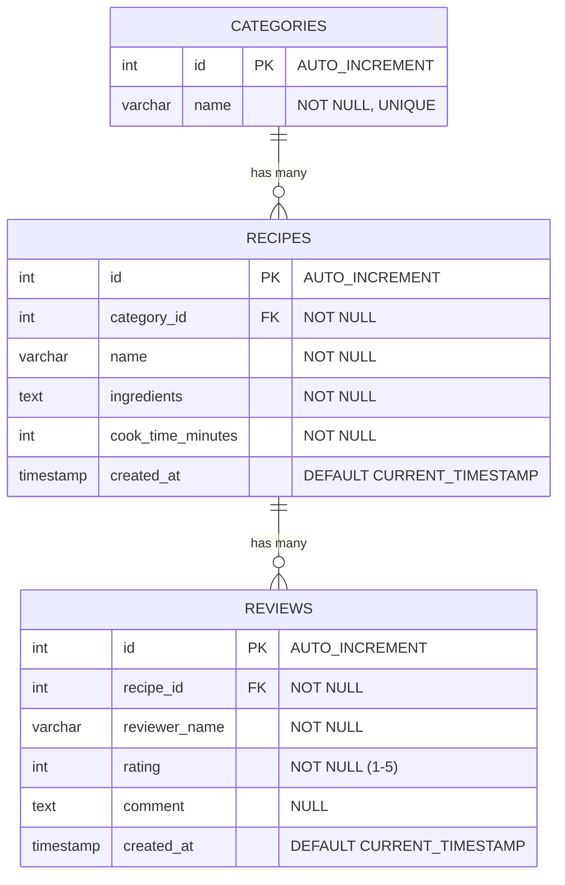

# Entity-Relationship Diagram (ERD)

แผนภาพแสดงความสัมพันธ์ของตารางในระบบข้อมูลสูตรอาหาร

## คำอธิบายเพิ่มเติมเกี่ยวกับ Database Constraints
1. **Primary Key (PK)**: `id` ของทุกตารางใช้ `INT AUTO_INCREMENT PRIMARY KEY`
2. **Foreign Key (FK)**: 
   - `category_id` ใน `recipes` อ้างอิงจาก `categories(id)` ด้วย `ON DELETE RESTRICT` (ไม่ให้ลบหมวดหมู่อาหารที่มีสูตรอาหารใช้งานอยู่) หรือใช้ `CASCADE` หากต้องการ
   - `recipe_id` ใน `reviews` อ้างอิงจาก `recipes(id)` ด้วย `ON DELETE CASCADE` เพื่อที่เวลากดลบสูตรอาหาร ระบบจะทำการลบรีวิวทั้งหมดของสูตรอาหารนั้นไปด้วยทันที
3. **UNIQUE Constraint**: 
   - `name` ใน `categories` ถูกกำหนดให้เป็น `UNIQUE` เพื่อป้องกันการตั้งชื่อหมวดหมู่ซ้ำซ้อนกันในระบบ
