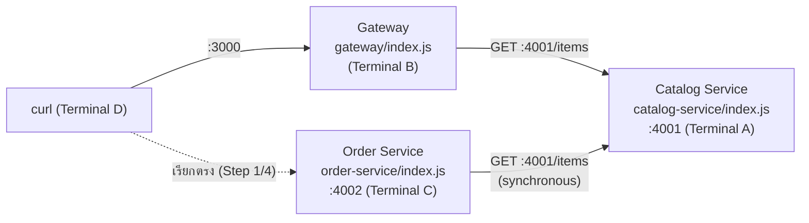
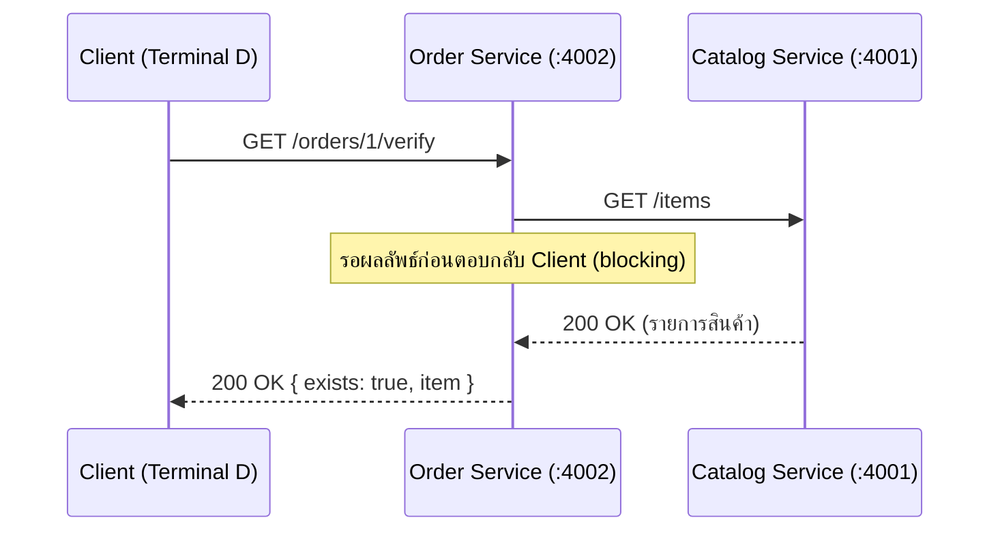

# สัปดาห์ที่ 13: ฝึกทำ Demo ด้วยตนเอง (Step-by-Step สำหรับนิสิต)

## วัตถุประสงค์ของเอกสารนี้

เอกสารนี้ให้นิสิตทำตามได้เองทีละ step บนเครื่องของตนเอง แต่ละ step อ้างอิงหัวข้อใน `wk13.md` โดยตรง พิมพ์โค้ดทีละบล็อกแล้วรันให้เห็นผลจริงด้วยตนเอง

Demo นี้สร้างโปรเจกต์ใหม่แยกต่างหากชื่อ `microservices-demo` (ไม่ใช่ `student-api`) เนื่องจากต้องรันหลาย process พร้อมกันเพื่อจำลองการแบ่งบริการ แยกจาก `student-api` ที่ใช้ต่อเนื่องในปฏิบัติการโดยสิ้นเชิง โปรเจกต์นี้เป็นของสาธิตเท่านั้น **ไม่ต้องเก็บรักษาหรือ fork ต่อ**

## สิ่งที่ต้องมีก่อนเริ่ม

- ติดตั้ง Node.js แล้ว (ตรวจสอบด้วย `node -v` ควรได้เลขเวอร์ชันกลับมา ไม่ใช่ error)
- มีความเข้าใจในปฏิบัติการที่ 11 (Resilience: Retry/Timeout/Fallback) และ 12 (Rate Limiting) มาแล้ว เพราะ demo นี้ต่อยอดจากแนวคิดเรื่อง `timeout`, `try/catch`, และ `express-rate-limit` ที่เรียนไปแล้วโดยตรง
- อ่าน `wk13.md` หัวข้อ 1-4 มาก่อน (โดยเฉพาะ 1.2, 2.1, 3.2, 4.1) เพราะเอกสารนี้จะไม่อธิบายทฤษฎีซ้ำ แต่จะอ้างอิงกลับไปที่หัวข้อเดิม

## ข้อควรรู้ก่อนเริ่ม: ต้องเปิด 3 terminal ค้างไว้พร้อมกัน

Demo นี้จำลองว่ามี 3 บริการแยกกันทำงานพร้อมกัน (Catalog Service, Gateway, Order Service) แต่ละบริการต้องรันด้วยคำสั่ง `node index.js` แล้ว**ปล่อยทิ้งไว้ไม่ต้องกด Ctrl+C** (หน้าจอจะค้างแสดงข้อความ เช่น `Catalog Service running on port 4001` ซึ่งถือเป็นเรื่องปกติ ไม่ใช่ error)

เปิด terminal ไว้ล่วงหน้า 4 หน้าต่าง:

1. Terminal A — สำหรับรัน Catalog Service (ปล่อยค้างไว้)
2. Terminal B — สำหรับรัน Gateway (ปล่อยค้างไว้)
3. Terminal C — สำหรับรัน Order Service (ปล่อยค้างไว้ เปิดใช้ตอน Step 4)
4. Terminal D — สำหรับพิมพ์คำสั่ง `curl` ทดสอบ (ใช้ terminal นี้พิมพ์คำสั่งทุกครั้งที่เอกสารบอกให้ `curl`)

ถ้าพิมพ์ `curl` แล้วได้ error ประเภท "Connection refused" หรือค้างไม่ตอบสนอง ให้ตรวจสอบก่อนว่า terminal ของบริการที่ต้องเรียกยังรันอยู่จริงหรือไม่ (ยังเห็นข้อความ `... running on port ...` อยู่ไหม)

```bash
mkdir microservices-demo && cd microservices-demo
mkdir catalog-service gateway
```

แผนภาพด้านล่างแสดงโครงสร้างสุดท้ายที่จะสร้างขึ้นหลังจบทุก step (รวม Order Service ที่สร้างใน Step 4) และพอร์ตที่แต่ละบริการใช้



---

## Step 1: พิสูจน์ปัญหาของสถาปัตยกรรมแบบ Monolithic (อ้างอิง wk13.md หัวข้อ 1.1)

### 1.1 ทบทวนโครงสร้างของ `student-api`

เปิดไฟล์ route ทั้งหมดของ `student-api` ของตนเอง (Auth, Students, Cache) แล้วสังเกตว่าทุกอย่างอยู่ใน repository และ process เดียวกัน

**ให้สังเกต**: หากต้องการ scale เฉพาะส่วน Authentication เพราะมีผู้ใช้ล็อกอินพร้อมกันจำนวนมาก จะต้อง scale ทั้งแอปพลิเคชันทั้งหมดไปด้วย แม้ส่วน CRUD ของ Students จะไม่ได้มีภาระงานสูงในขณะนั้นก็ตาม ตรงกับข้อจำกัดด้านการ Scale ที่อธิบายไว้ในตารางเปรียบเทียบหัวข้อ 1.3 ของ `wk13.md`

---

## Step 2: สร้างบริการย่อยตาม Bounded Context (อ้างอิง wk13.md หัวข้อ 2)

### 2.1 สร้าง Catalog Service

ใน **Terminal A**:

```bash
cd catalog-service
npm init -y
npm install express
```

สร้างไฟล์ `catalog-service/index.js` ด้วยเนื้อหานี้:

```javascript
// catalog-service/index.js
const express = require("express");
const app = express();
app.use(express.json());

const items = [
  { id: 1, title: "Node.js เบื้องต้น" },
  { id: 2, title: "Express.js ขั้นสูง" },
];

app.get("/items", (req, res) => {
  res.status(200).json({ data: items });
});

app.listen(4001, () => console.log("Catalog Service running on port 4001"));
```

รันค้างไว้ใน Terminal A (ห้ามกด Ctrl+C ต่อจากนี้):

```bash
node index.js
```

ควรเห็นข้อความ `Catalog Service running on port 4001` ค้างอยู่หน้าจอ

สลับไป **Terminal D** ทดสอบเรียกตรงด้วย `curl`:

```bash
curl http://localhost:4001/items
```

ผลลัพธ์ที่ควรได้ (รูปแบบ JSON):

```json
{
  "data": [
    { "id": 1, "title": "Node.js เบื้องต้น" },
    { "id": 2, "title": "Express.js ขั้นสูง" }
  ]
}
```

**ให้สังเกต**: Catalog Service ตอบสนองได้อย่างอิสระโดยไม่เกี่ยวข้องกับบริการอื่นใดเลย ตรงกับคุณสมบัติ "พัฒนา ทดสอบ และ deploy แยกจากบริการอื่นได้อย่างอิสระ" ในหัวข้อ 1.2 ของ `wk13.md`

---

## Step 3: สร้าง API Gateway (อ้างอิง wk13.md หัวข้อ 3)

### 3.1 พิสูจน์ปัญหาเมื่อไม่มี Gateway

ใน **Terminal D** (Catalog Service ใน Terminal A ยังต้องรันอยู่):

```bash
curl http://localhost:4001/items
```

**ให้สังเกต**: Client ต้องทราบพอร์ต `4001` ของ Catalog Service โดยตรง หากในอนาคตมีบริการที่สอง (เช่น Order Service บนพอร์ต 4002) Client ต้องทราบและจัดการที่อยู่ของทุกบริการเอง ตรงกับปัญหาข้อ 1 ในหัวข้อ 3.1 ของ `wk13.md`

### 3.2 สร้าง Gateway ทำหน้าที่ Routing

ใน **Terminal B** (เปิด terminal ใหม่ อย่าใช้ Terminal A ที่ Catalog Service กำลังรันอยู่):

```bash
cd microservices-demo/gateway
npm init -y
npm install express axios express-rate-limit
```

สร้างไฟล์ `gateway/index.js` ด้วยเนื้อหานี้ (ส่วน `generalLimiter` ใช้ไลบรารีเดียวกับที่ติดตั้งในปฏิบัติการสัปดาห์ที่ 12 เพื่อสาธิตว่า Rate Limiting ส่วนกลางตามหัวข้อ 3.2 ของ `wk13.md` ทำที่ชั้น Gateway เพียงจุดเดียว แทนที่จะต้องเขียนซ้ำในทุกบริการย่อย):

```javascript
// gateway/index.js
const express = require("express");
const axios = require("axios");
const rateLimit = require("express-rate-limit");
const app = express();

const generalLimiter = rateLimit({
  windowMs: 60 * 1000,
  max: 5, // ตั้งค่าต่ำเพื่อให้ demo เห็นผล 429 ได้ง่ายภายในคาบเรียน
  standardHeaders: "draft-7",
  legacyHeaders: false,
  message: {
    error: { code: "TOO_MANY_REQUESTS", message: "เรียกบ่อยเกินกำหนด กรุณาลองใหม่ภายหลัง" },
  },
});

app.set("trust proxy", 1);
app.use(generalLimiter);

app.use("/api/v1/items", async (req, res) => {
  try {
    const response = await axios.get("http://localhost:4001/items", {
      timeout: 3000,
    });
    res.status(response.status).json(response.data);
  } catch (error) {
    res.status(503).json({
      error: {
        code: "SERVICE_UNAVAILABLE",
        message: "Catalog service ไม่พร้อมใช้งาน",
      },
    });
  }
});

app.listen(3000, () => console.log("API Gateway running on port 3000"));
```

รันค้างไว้ใน Terminal B:

```bash
node index.js
```

ควรเห็นข้อความ `API Gateway running on port 3000` ค้างอยู่หน้าจอ (ตอนนี้ Terminal A และ B ควรรันค้างไว้พร้อมกันทั้งคู่)

ใน **Terminal D**:

```bash
curl http://localhost:3000/api/v1/items
```

ผลลัพธ์ที่ควรได้ควรเหมือนกับ Step 2 ทุกตัวอักษร (เพราะ Gateway เพียงส่งต่อคำขอไปยัง Catalog Service แล้วคืนผลลัพธ์เดิมกลับมา)

**ให้สังเกต**: Client เรียกผ่านพอร์ต `3000` เพียงจุดเดียว โดยไม่จำเป็นต้องทราบว่า Catalog Service อยู่ที่พอร์ต `4001` เลย ตรงกับหลักการ single entry point ในหัวข้อ 3.2 ของ `wk13.md`

### 3.3 พิสูจน์ Rate Limiting ส่วนกลางที่ชั้น Gateway

ใน **Terminal D** รัน `curl` ซ้ำ ๆ ติดกัน 6 ครั้งภายใน 1 นาที (เกินค่า `max: 5` ที่ตั้งไว้):

```bash
curl -i http://localhost:3000/api/v1/items
curl -i http://localhost:3000/api/v1/items
curl -i http://localhost:3000/api/v1/items
curl -i http://localhost:3000/api/v1/items
curl -i http://localhost:3000/api/v1/items
curl -i http://localhost:3000/api/v1/items
```

ครั้งที่ 6 ควรได้สถานะ `429 Too Many Requests` พร้อมข้อความ `เรียกบ่อยเกินกำหนด กรุณาลองใหม่ภายหลัง` (ไม่ใช่ `503` ของหัวข้อถัดไป — คนละกรณีกัน: `429` คือ Gateway ปฏิเสธเองเพราะเรียกถี่เกินไป ส่วน `503` คือ Catalog Service ปลายทางล่ม)

**ให้สังเกต**: Gateway นับจำนวนคำขอและปฏิเสธคำขอที่เกินโควตาได้โดย Catalog Service และ Order Service **ไม่ต้องรู้เรื่อง Rate Limiting เลย** เพราะ Gateway ทำหน้าที่นี้แทนให้ที่จุดเดียว ตรงกับแถว "Rate Limiting ส่วนกลาง" ในตารางหัวข้อ 3.2 ของ `wk13.md` และต่อยอดจากไลบรารี `express-rate-limit` ที่เรียนในสัปดาห์ที่ 12 โดยตรง

รอประมาณ 1 นาที (ให้ครบ `windowMs`) ก่อนไปหัวข้อถัดไป เพื่อให้โควตารีเซ็ตใหม่

### 3.4 พิสูจน์ Fallback ของ Gateway เมื่อบริการปลายทางล่ม

ไปที่ **Terminal A** กด `Ctrl+C` เพื่อหยุด Catalog Service (Gateway ใน Terminal B ปล่อยรันค้างไว้ต่อไป ไม่ต้องหยุด)

ใน **Terminal D**:

```bash
curl -i http://localhost:3000/api/v1/items
```

ผลลัพธ์ที่ควรได้: สถานะ `503 Service Unavailable` พร้อมข้อความ `Catalog service ไม่พร้อมใช้งาน`

**ให้สังเกต**: Gateway คืนค่า `503 Service Unavailable` พร้อมข้อความที่มีความหมาย แทนที่จะค้างรอไม่มีกำหนดหรือคืน error ที่ไม่มีคำอธิบาย เพราะ Gateway ครอบการเรียกด้วย `try/catch` และ `timeout` เช่นเดียวกับหลักการ Resilience ที่เรียนในสัปดาห์ที่ 11 ตรงกับหัวข้อ 3.3 ของ `wk13.md`

**ก่อนไป Step ถัดไป**: กลับไปที่ **Terminal A** แล้วรัน Catalog Service ขึ้นมาใหม่ (อยู่ในโฟลเดอร์ `catalog-service` อยู่แล้ว ไม่ต้อง `cd` ซ้ำ):

```bash
node index.js
```

ยืนยันว่า Catalog Service กลับมาทำงานแล้วโดย `curl http://localhost:4001/items` ใน Terminal D อีกครั้งก่อนไปต่อ

---

## Step 4: Synchronous Communication ระหว่างบริการ (อ้างอิง wk13.md หัวข้อ 4.1)

### 4.1 สร้างบริการที่สองเรียกบริการแรกโดยตรง

ใน **Terminal C** (เปิด terminal ใหม่ อย่าใช้ Terminal A หรือ B ที่กำลังรันอยู่):

```bash
cd microservices-demo
mkdir order-service && cd order-service
npm init -y
npm install express axios
```

สร้างไฟล์ `order-service/index.js` ด้วยเนื้อหานี้:

```javascript
// order-service/index.js
const express = require("express");
const axios = require("axios");
const app = express();

app.get("/orders/:itemId/verify", async (req, res) => {
  try {
    const response = await axios.get("http://localhost:4001/items", {
      timeout: 3000,
    });
    const item = response.data.data.find(
      (i) => i.id === Number(req.params.itemId),
    );
    res.status(200).json({ data: { exists: !!item, item } });
  } catch (error) {
    res.status(503).json({ error: { code: "CATALOG_UNAVAILABLE" } });
  }
});

app.listen(4002, () => console.log("Order Service running on port 4002"));
```

รันค้างไว้ใน Terminal C:

```bash
node index.js
```

ควรเห็นข้อความ `Order Service running on port 4002` ค้างอยู่หน้าจอ (ตอนนี้ Terminal A, B, C ควรรันค้างไว้พร้อมกันทั้ง 3 ตัว)

ใน **Terminal D**:

```bash
curl http://localhost:4002/orders/1/verify
```

ผลลัพธ์ที่ควรได้:

```json
{
  "data": { "exists": true, "item": { "id": 1, "title": "Node.js เบื้องต้น" } }
}
```

ลองเปลี่ยนเป็น `curl http://localhost:4002/orders/99/verify` (ไม่มี item id นี้) ควรได้ `"exists":false` และ `"item":null`

**ให้สังเกต**: Order Service เรียก Catalog Service โดยตรงผ่าน HTTP (พอร์ต `4001`) แล้วรอผลลัพธ์ก่อนตอบกลับ Client รูปแบบนี้เหมือนกับการเรียก external API ทุกประการ เพียงแต่ปลายทางเป็นบริการภายในระบบเดียวกัน ตรงกับหัวข้อ 4.1 และ 4.3 ของ `wk13.md` ที่ว่าหลักการ Resilience จากสัปดาห์ที่ 11 ใช้ได้กับการเรียกระหว่างบริการเช่นกัน



---

## เมื่อทำครบทุก Step แล้ว

กด `Ctrl+C` ใน Terminal A, B, C เพื่อหยุดทั้ง 3 บริการ (Terminal D ไม่มีอะไรต้องหยุดเพราะใช้พิมพ์ `curl` เท่านั้น)

โค้ดสุดท้ายที่ได้ครอบคลุมสาระสำคัญทั้งหมดของ `wk13.md`: ข้อจำกัดของสถาปัตยกรรมแบบ Monolithic ด้าน Scale, การแบ่งบริการย่อยตาม Bounded Context ที่ทำงานอิสระจากกัน, บทบาทของ API Gateway ในการเป็นจุดเข้าถึงเดียวพร้อม Fallback เมื่อบริการปลายทางล่ม, และรูปแบบ Synchronous Communication ระหว่างบริการภายในระบบเดียวกัน

**ข้อควรระวัง**: โปรเจกต์ `microservices-demo` นี้เป็นของฝึกเท่านั้น ไม่ต้องเก็บรักษาหรือ fork ต่อ ให้นำแนวคิดเดียวกันไปทำงานจริงบน `student-api` (`services-lab/`) ตาม `wk13-lab.md` และออกแบบไฟล์ `microservices-design.md` ของระบบโครงงานตนเองตาม `wk13-assignment.md`

เนื้อหาเรื่อง Circuit Breaker และ Asynchronous Communication ผ่าน Message Queue (หัวข้อ 4.2-4.3 ของ `wk13.md`) เป็นหัวข้ออ่านเพื่อรู้ ไม่ต้องลงมือเขียนโค้ดในเอกสารนี้
