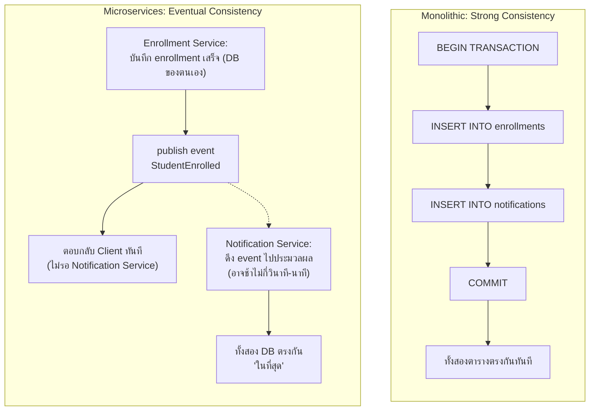

# สัปดาห์ที่ 13: Eventual Consistency แบบละเอียด (เอกสารเสริม)

## วัตถุประสงค์ของเอกสารนี้

เอกสารนี้ขยายความหัวข้อ 4.2 (Asynchronous Communication) ของ `wk13.md` ในส่วน **Eventual Consistency** ให้ละเอียดขึ้น พร้อมตัวอย่างโค้ดจำลอง (mock) ให้นิสิตเห็นภาพการทำงานจริง เอกสารนี้เป็น**เนื้อหาเสริมเพื่อความเข้าใจ ไม่ใช่ภาคปฏิบัติที่ต้องส่งงาน** ตามที่ `wk13.md` หัวข้อ 4.2 ระบุไว้ว่า "การฝึกภาคปฏิบัติของสัปดาห์นี้เน้นที่ Synchronous Communication ... ส่วน Message Queue/Broker ... อยู่นอกขอบเขตการฝึกภาคปฏิบัติของรายวิชานี้"

กล่าวอีกนัยหนึ่ง: **Eventual Consistency ไม่ใช่เทคนิคที่ "เขียนโค้ดทำ" ได้ตรง ๆ บรรทัดเดียว แต่เป็นผลลัพธ์ที่เกิดขึ้นเองจากการออกแบบระบบด้วย Asynchronous Communication** เอกสารนี้จะแสดงให้เห็นว่าผลลัพธ์นั้นเกิดขึ้นอย่างไร และนิสิตต้องออกแบบรับมือกับมันอย่างไร

## สารบัญ

1. [ทบทวนนิยาม](#1-ทบทวนนิยาม)
2. [เหตุผลที่เกิดขึ้น: ทำไม Microservices ถึงหลีกเลี่ยง Eventual Consistency ไม่ได้](#2-เหตุผลที่เกิดขึ้น-ทำไม-microservices-ถึงหลีกเลี่ยง-eventual-consistency-ไม่ได้)
3. [ตัวอย่างจำลองด้วยโค้ด: Enrollment Service + Notification Service ผ่าน Message Broker](#3-ตัวอย่างจำลองด้วยโค้ด-enrollment-service--notification-service-ผ่าน-message-broker)
4. [ปัญหาที่ต้องออกแบบรับมือเพิ่ม](#4-ปัญหาที่ต้องออกแบบรับมือเพิ่ม-ไม่ใช่-ทำ-eventual-consistency-แต่คือ-ออกแบบให้ทนทานกับผลข้างเคียงของมัน)
   - 4.1 [Idempotency (ประมวลผลซ้ำได้โดยไม่เกิดผลซ้ำ)](#41-idempotency-ประมวลผลซ้ำได้โดยไม่เกิดผลซ้ำ)
   - 4.2 [การสื่อสารกับผู้ใช้ระหว่างช่วง inconsistent](#42-การสื่อสารกับผู้ใช้ระหว่างช่วง-inconsistent)
   - 4.3 [ลำดับของ Event (Event Ordering)](#43-ลำดับของ-event-event-ordering)
5. [เปรียบเทียบกับตัวอย่างในชีวิตจริงอีกครั้ง](#5-เปรียบเทียบกับตัวอย่างในชีวิตจริงอีกครั้ง-เชื่อมกับ-wk13md-หัวข้อ-42)
6. [สรุปเนื้อหาสำคัญ](#สรุปเนื้อหาสำคัญ)
7. [เอกสารอ้างอิง](#เอกสารอ้างอิง-reference)

---

## 1. ทบทวนนิยาม

**Eventual Consistency** (ความสอดคล้องกันในที่สุด) คือหลักการที่ข้อมูลในระบบแบบกระจาย (distributed system) ไม่จำเป็นต้องตรงกันทันทีในทุกจุดหลังมีการเปลี่ยนแปลง แต่รับประกันว่าหากไม่มีการเปลี่ยนแปลงเพิ่มเติมเข้ามาอีก ข้อมูลทุกจุดจะตรงกันในที่สุดภายในเวลาอันสั้น

แนวคิดนี้ตรงข้ามกับ **Strong Consistency** ที่ระบบ Monolithic ใช้ transaction เดียวบันทึกข้อมูลหลายส่วนพร้อมกันได้ทันที (ดูเปรียบเทียบในตารางหัวข้อ 1.3 ของ `wk13.md` แถว "ความสอดคล้องของข้อมูล")

| ประเด็น                  | Strong Consistency (Monolithic + transaction เดียว)      | Eventual Consistency (Microservices + Message Broker)                 |
| ------------------------ | --------------------------------------------------------- | ----------------------------------------------------------------------- |
| เวลาที่ข้อมูลตรงกัน      | ทันทีหลัง transaction commit                              | ภายในเวลาอันสั้น (มิลลิวินาทีถึงไม่กี่นาที) หลัง event ถูกประมวลผล      |
| กลไกที่ใช้                | Database transaction (ACID) เดียวครอบทุกตาราง              | Message Broker ส่ง event ให้บริการปลายทางประมวลผลแยกจากกัน              |
| ผลกระทบต่อผู้เรียก        | ต้องรอ transaction เสร็จก่อนได้รับคำตอบ (coupling ด้านเวลา) | ได้รับคำตอบทันทีโดยไม่ต้องรอบริการปลายทาง (decoupling ด้านเวลา)         |
| ความซับซ้อนในการจัดการ    | ต่ำ (database จัดการให้)                                   | สูงขึ้น ต้องออกแบบรับมือ event ซ้ำ, ลำดับ event ผิด, event สูญหาย เองเพิ่ม |

---

## 2. เหตุผลที่เกิดขึ้น: ทำไม Microservices ถึงหลีกเลี่ยง Eventual Consistency ไม่ได้

ย้อนไปที่หัวข้อ 1.2 ของ `wk13.md`: แต่ละบริการใน Microservices มักมี **database เป็นของตนเอง** (database per service) เพื่อลดการพึ่งพากันโดยตรงระดับข้อมูล ผลที่ตามมาคือ **ไม่มี transaction เดียวที่ครอบคลุมทุกบริการได้** อีกต่อไป

ลองเทียบสถานการณ์เดียวกัน (นิสิตลงทะเบียนเรียนสำเร็จ แล้วต้องส่งอีเมลแจ้งเตือน) ในสองสถาปัตยกรรม:



ฝั่ง Monolithic: ถ้า `INSERT INTO notifications` ล้มเหลว ทั้ง transaction จะ `ROLLBACK` ทำให้ `enrollments` ก็ไม่ถูกบันทึกไปด้วย — ข้อมูลตรงกันเสมอ (all-or-nothing)

ฝั่ง Microservices: Enrollment Service บันทึกสำเร็จและตอบกลับไปแล้ว **ก่อน** ที่ Notification Service จะเริ่มทำงานด้วยซ้ำ จึงไม่มีทางย้อนกลับ (rollback) ข้าม 2 บริการได้แบบ Monolithic — นี่คือข้อแลกเปลี่ยนที่ยอมรับเพื่อให้ได้ decoupling ด้านเวลาตามหัวข้อ 4.2 ของ `wk13.md`

---

## 3. ตัวอย่างจำลองด้วยโค้ด: Enrollment Service + Notification Service ผ่าน Message Broker

ตัวอย่างนี้จำลอง Message Broker ด้วย `EventEmitter` ของ Node.js (มีอยู่แล้วใน Node.js core ไม่ต้องติดตั้งไลบรารีเพิ่ม) เพื่อให้เห็น**พฤติกรรม**ของ Eventual Consistency แบบรันดูได้จริงโดยไม่ต้องตั้งค่า RabbitMQ/Kafka ซึ่งอยู่นอกขอบเขตภาคปฏิบัติของวิชานี้ **ย้ำว่าของจริงในระดับ production ต้องใช้ Message Broker เฉพาะทาง (RabbitMQ, Apache Kafka) ไม่ใช่ EventEmitter ภายใน process เดียวแบบนี้** เพราะ EventEmitter ทำงานได้เฉพาะภายใน process เดียวกันเท่านั้น ไม่สามารถส่ง event ข้าม process หรือข้ามเครื่องได้จริงเหมือน Message Broker ของจริง

```javascript
// broker-demo.js
// รันด้วย: node broker-demo.js
const EventEmitter = require("events");

// จำลอง Message Broker ด้วย EventEmitter (ของจริงคือ RabbitMQ/Kafka)
const broker = new EventEmitter();

// จำลองฐานข้อมูลแยกกันคนละบริการ (database per service)
const enrollmentDB = [];
const notificationDB = [];

// ---------- Enrollment Service ----------
function enrollStudent(studentId, courseId) {
  // 1. บันทึกข้อมูลลง DB ของ Enrollment Service เอง
  const record = { studentId, courseId, enrolledAt: new Date().toISOString() };
  enrollmentDB.push(record);
  console.log(`[Enrollment Service] บันทึกสำเร็จ:`, record);

  // 2. publish event แล้ว "ตอบกลับ Client ได้ทันที" โดยไม่รอ Notification Service
  broker.emit("StudentEnrolled", record);
  console.log(`[Enrollment Service] ตอบกลับ Client แล้ว (ไม่รอ Notification Service)`);

  return record;
}

// ---------- Notification Service ----------
// subscribe event "StudentEnrolled" แล้วประมวลผล "ภายหลัง"
broker.on("StudentEnrolled", (record) => {
  // จำลองความล่าช้าของการส่งอีเมลจริง (เช่น เรียก external API ของผู้ให้บริการอีเมล)
  const delayMs = 2000;
  console.log(
    `[Notification Service] ได้รับ event แล้ว กำลังส่งอีเมล (จะเสร็จใน ${delayMs}ms)...`,
  );

  setTimeout(() => {
    notificationDB.push({ studentId: record.studentId, emailSentAt: new Date().toISOString() });
    console.log(`[Notification Service] ส่งอีเมลสำเร็จให้นิสิต ${record.studentId}`);
    console.log(`[Notification Service] notificationDB ปัจจุบัน:`, notificationDB);
  }, delayMs);
});

// ---------- Demo ----------
console.log("=== เริ่ม Demo Eventual Consistency ===\n");
enrollStudent("65010001", "CS101");

// ตรวจสอบสถานะ "ทันที" หลัง enrollStudent คืนค่า
console.log("\n--- ตรวจสอบทันทีหลังลงทะเบียน (ก่อน Notification Service ทำงานเสร็จ) ---");
console.log("enrollmentDB:", enrollmentDB);
console.log("notificationDB:", notificationDB, "<- ยังว่างอยู่ นี่คือช่วง inconsistent ชั่วคราว");
```

### ผลลัพธ์ที่คาดว่าจะได้เมื่อรัน `node broker-demo.js`

```
=== เริ่ม Demo Eventual Consistency ===

[Enrollment Service] บันทึกสำเร็จ: { studentId: '65010001', courseId: 'CS101', enrolledAt: '...' }
[Enrollment Service] ตอบกลับ Client แล้ว (ไม่รอ Notification Service)
[Notification Service] ได้รับ event แล้ว กำลังส่งอีเมล (จะเสร็จใน 2000ms)...

--- ตรวจสอบทันทีหลังลงทะเบียน (ก่อน Notification Service ทำงานเสร็จ) ---
enrollmentDB: [ { studentId: '65010001', courseId: 'CS101', enrolledAt: '...' } ]
notificationDB: [] <- ยังว่างอยู่ นี่คือช่วง inconsistent ชั่วคราว

(รอประมาณ 2 วินาที)

[Notification Service] ส่งอีเมลสำเร็จให้นิสิต 65010001
[Notification Service] notificationDB ปัจจุบัน: [ { studentId: '65010001', emailSentAt: '...' } ]
```

**จุดสำคัญที่ต้องสังเกตจากผลลัพธ์**:

1. `enrollmentDB` มีข้อมูลทันทีหลัง `enrollStudent()` คืนค่า แต่ `notificationDB` ยังว่างอยู่ — นี่คือ**ช่วงเวลา inconsistent ชั่วคราว** ที่หัวข้อ 4.2 ของ `wk13.md` อธิบายไว้
2. หลังจากรอประมาณ 2 วินาที (เวลาจำลองการส่งอีเมล) `notificationDB` จึงมีข้อมูลตรงกับ `enrollmentDB` — นี่คือ**"ในที่สุด" (eventually)** ที่ชื่อหลักการนี้สื่อถึง
3. Enrollment Service ไม่ได้รอ Notification Service เลย (`ตอบกลับ Client แล้ว` ปรากฏขึ้นก่อนที่ Notification Service จะเริ่มทำงานเสร็จด้วยซ้ำ)

---

## 4. ปัญหาที่ต้องออกแบบรับมือเพิ่ม (ไม่ใช่ "ทำ Eventual Consistency" แต่คือ "ออกแบบให้ทนทานกับผลข้างเคียงของมัน")

เนื่องจาก Eventual Consistency ไม่ได้มี transaction รับประกัน การออกแบบระบบ Asynchronous ที่ดีต้องคำนึงถึงปัญหาต่อไปนี้เพิ่มเติม

### 4.1 Idempotency (ประมวลผลซ้ำได้โดยไม่เกิดผลซ้ำ)

**Idempotency** หมายถึงคุณสมบัติที่การประมวลผลคำขอเดิมซ้ำหลายครั้งให้ผลลัพธ์เหมือนกับประมวลผลครั้งเดียว Message Broker ของจริง (RabbitMQ, Kafka) อาจส่ง event ซ้ำได้ในบางสถานการณ์ (เช่น เครือข่ายขัดข้องแล้ว retry การส่ง) หากบริการปลายทางไม่ได้ป้องกันไว้ นิสิตอาจได้รับอีเมลแจ้งเตือนซ้ำสองฉบับจาก event เดียวกัน

ตัวอย่างการป้องกันแบบง่าย (เพิ่มการตรวจสอบก่อนประมวลผลใน `broker-demo.js` ข้างต้น):

```javascript
// แก้ไข Notification Service ให้ป้องกัน event ซ้ำ (idempotency)
const processedEnrollmentIds = new Set();

broker.on("StudentEnrolled", (record) => {
  const eventKey = `${record.studentId}-${record.courseId}`;

  // ตรวจสอบก่อนว่า event นี้เคยประมวลผลไปแล้วหรือยัง
  if (processedEnrollmentIds.has(eventKey)) {
    console.log(`[Notification Service] ข้าม event ซ้ำ: ${eventKey}`);
    return;
  }
  processedEnrollmentIds.add(eventKey);

  setTimeout(() => {
    notificationDB.push({ studentId: record.studentId, emailSentAt: new Date().toISOString() });
    console.log(`[Notification Service] ส่งอีเมลสำเร็จให้นิสิต ${record.studentId}`);
  }, 2000);
});
```

### 4.2 การสื่อสารกับผู้ใช้ระหว่างช่วง inconsistent

เนื่องจากมีช่วงเวลาที่ข้อมูลยังไม่ตรงกัน (ตามข้อ 3 ด้านบน) ฝั่ง UI/Client ต้องออกแบบให้สื่อสารกับผู้ใช้อย่างเหมาะสม เช่น

- แสดงสถานะ "กำลังดำเนินการ" หรือ "ลงทะเบียนสำเร็จ กำลังส่งอีเมลยืนยัน" แทนการบอกว่าทุกอย่างเสร็จสมบูรณ์แล้วทันที
- หากต้องแสดงสถานะล่าสุดของ Notification ให้ Client ต้อง poll หรือ subscribe ผลลัพธ์เพิ่มเติม (เช่น ผ่าน WebSocket หรือ refresh หน้าเว็บ) ไม่ใช่คาดหวังว่าจะได้ผลลัพธ์ครบในคำตอบเดียวเหมือน Synchronous

### 4.3 ลำดับของ Event (Event Ordering)

Message Broker บางชนิดไม่รับประกันว่า event จะถูกประมวลผลตามลำดับที่ส่งเสมอไป (ขึ้นกับการตั้งค่า partition/queue) หากระบบมีหลาย event ที่ลำดับมีความสำคัญ (เช่น `StudentEnrolled` ต้องมาก่อน `PaymentReceived` เสมอ) ต้องออกแบบเพิ่มเติม เช่น ใส่ sequence number หรือ timestamp ตรวจสอบลำดับที่ฝั่งผู้รับ ประเด็นนี้เป็นเรื่องขั้นสูงที่ลึกกว่าขอบเขตของวิชานี้ นิสิตที่สนใจสามารถศึกษาเพิ่มเติมได้จากเอกสารอ้างอิงด้านท้าย

---

## 5. เปรียบเทียบกับตัวอย่างในชีวิตจริงอีกครั้ง (เชื่อมกับ wk13.md หัวข้อ 4.2)

`wk13.md` ยกตัวอย่างการสั่งซื้อสินค้าออนไลน์และการอัปโหลดวิดีโอไว้แล้ว ตารางด้านล่างสรุปองค์ประกอบที่ตรงกันทั้ง 3 กรณี เพื่อให้เห็นว่าโครงสร้างเดียวกันนี้ใช้ได้กับสถานการณ์ที่หลากหลาย

| องค์ประกอบ                        | สั่งซื้อสินค้าออนไลน์         | อัปโหลดวิดีโอ                    | ลงทะเบียนเรียน (ตัวอย่างในเอกสารนี้) |
| ---------------------------------- | ------------------------------ | --------------------------------- | --------------------------------------- |
| บริการผู้ส่ง (publisher)           | บริการสั่งซื้อ                 | บริการอัปโหลด                     | Enrollment Service                      |
| สิ่งที่บันทึกเสร็จก่อนตอบกลับ      | รายการสั่งซื้อ                 | ไฟล์ต้นฉบับถูกเก็บ                | ข้อมูลการลงทะเบียน (`enrollmentDB`)     |
| Event ที่ publish                  | `OrderPlaced`                  | `VideoUploaded`                   | `StudentEnrolled`                       |
| บริการปลายทาง (subscriber)         | บริการส่งอีเมล/SMS              | บริการแปลงไฟล์วิดีโอ              | Notification Service                    |
| งานที่ยังไม่เสร็จตอนตอบกลับ Client | ส่งอีเมล/SMS ยืนยัน             | แปลงไฟล์เป็นหลายความละเอียด        | ส่งอีเมลแจ้งเตือน (`notificationDB`)    |
| ระยะเวลาช่วง inconsistent          | เสี้ยววินาทีถึงไม่กี่วินาที      | หลายนาที (ขึ้นกับความยาวคลิป)      | ประมาณ 2 วินาที (จำลองในโค้ด)           |

---

## สรุปเนื้อหาสำคัญ

1. Eventual Consistency ไม่ใช่เทคนิคที่เขียนโค้ดทำโดยตรง แต่เป็น**ผลลัพธ์ที่เกิดขึ้นเอง**จากการออกแบบระบบด้วย Asynchronous Communication ผ่าน Message Broker ร่วมกับการที่แต่ละบริการมี database เป็นของตนเอง
2. ช่วงเวลาที่ข้อมูลยังไม่ตรงกัน (inconsistency window) เป็นข้อแลกเปลี่ยนที่ต้องยอมรับ เพื่อให้บริการผู้ส่งไม่ต้องรอบริการปลายทาง (decoupling ด้านเวลา)
3. การออกแบบระบบ Asynchronous ที่ดีต้องรับมือเพิ่มเติมกับ Idempotency (ป้องกัน event ซ้ำ), การสื่อสารสถานะกับผู้ใช้อย่างเหมาะสม, และ Event Ordering ในกรณีที่ลำดับมีความสำคัญ
4. เนื้อหานี้เป็นส่วนเสริมเพื่อความเข้าใจ ภาคปฏิบัติของวิชานี้ยังเน้นที่ Synchronous Communication ตาม `wk13-lab.md` และ `wk13-demo-step-by-step-student.md` ไม่ต้อง setup Message Broker จริงเพื่อส่งงาน

---

## เอกสารอ้างอิง (Reference)

1. Node.js. _Events | Node.js Documentation_ (เอกสาร `EventEmitter` ที่ใช้จำลอง Message Broker ในตัวอย่างนี้). สืบค้นจาก https://nodejs.org/docs/latest/api/events.html
2. microservices.io. _Pattern: Saga_ (แนวทางจัดการ transaction ข้ามบริการเมื่อไม่มี Strong Consistency). สืบค้นจาก https://microservices.io/patterns/data/saga.html
3. microservices.io. _Pattern: Idempotent Consumer_. สืบค้นจาก https://microservices.io/patterns/communication-style/idempotent-consumer.html
4. AWS. _What is Eventual Consistency?_. สืบค้นจาก https://aws.amazon.com/what-is/eventual-consistency/
