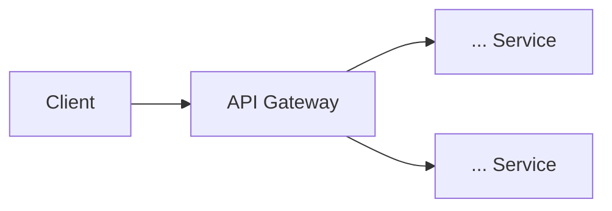

# ปฏิบัติการสัปดาห์ที่ 13: ออกแบบและทดลองแยกบริการแบบ Microservices

## วัตถุประสงค์ของปฏิบัติการ

เมื่อทำปฏิบัติการนี้เสร็จสิ้น นิสิตจะสามารถ

1. วิเคราะห์และแบ่งระบบ Monolithic เดิมออกเป็นบริการย่อยตามแนวคิด Bounded Context
2. สร้าง Student Service ที่รันเป็น process แยกจาก `student-api` เดิม จำลองการแบ่งความรับผิดชอบของ endpoint ที่เคยรวมอยู่ในโปรเจกต์เดียว
3. สร้าง API Gateway จำลองด้วย Express ที่ทำหน้าที่ routing และ authentication ส่วนกลาง (หมายเหตุ: Gateway ไม่ใช่ "บริการย่อย" ตามหลัก Bounded Context ในหัวข้อ 2 ของ `wk13.md` แต่เป็นจุดเข้าถึงเดียวที่อยู่หน้าบริการย่อย — ขั้นตอนหลักของ lab นี้จึงมีบริการย่อยจริงเพียง 1 บริการ คือ Student Service ส่วนการเพิ่มบริการย่อยที่ 2 ให้ครบตามแนวคิด Microservices ทำในแบบฝึกหัดต่อยอดที่ 1)
4. เรียกข้ามบริการผ่าน Gateway ได้สำเร็จ ทั้งกรณีปกติและกรณีบริการปลายทางไม่พร้อมใช้งาน
5. บันทึกผลการออกแบบสถาปัตยกรรมของระบบโครงงานของตนเองเป็นเอกสารประกอบใบงาน

ปฏิบัติการนี้ต่อยอดจากเนื้อหาบรรยายในเอกสาร `wk13.md` และเทคนิค Axios/Retry/Timeout/Fallback จากสัปดาห์ที่ 11 ผลลัพธ์จากขั้นตอนที่ 1-3 ฝึกบนโปรเจกต์ตัวอย่าง `student-api` ส่วนขั้นตอนสุดท้าย (ส่วนที่ 3) ให้นิสิตนำแนวคิดเดียวกันไปออกแบบ (ไม่จำเป็นต้องแยกโค้ดจริงทั้งหมด) กับระบบโครงงานของตนเองแล้วส่งเป็นใบงานสัปดาห์ที่ 13 (วัดผล CLO1/PLO1 และ CLO8/PLO14) ใบงานนี้เป็นส่วนหนึ่งของโครงงานหลัก CLO8 (พัฒนา Backend Service ที่รองรับฐานข้อมูลและตรงความต้องการผู้ใช้) ต่อเนื่องจากระยะที่ 1 (`wk05-project-phase1.md`, สัปดาห์ที่ 5: DB/Requirement) และผลลัพธ์ของสัปดาห์นี้ (การออกแบบ Microservices) จะถูกนำไปรวมเข้ากับระยะที่ 3 (`wk15-project-phase3.md`, สัปดาห์ที่ 15: Final Integration) หมายเหตุ: คำว่า "โครงงานระยะที่ 2" ในรายวิชานี้หมายถึง `wk10-project-phase2.md` (Docs/DX & Integration, วัดผล CLO8) เท่านั้น งานของสัปดาห์นี้จึงไม่ใช้คำว่า "ระยะที่ 2" เพื่อไม่ให้สับสนกัน

## เวลาที่ใช้

| ช่วงเวลา    | กิจกรรม                                                                        |
| ----------- | ------------------------------------------------------------------------------ |
| 0-15 นาที   | ทบทวนเนื้อหาสัปดาห์ที่ 12 (Review W12 — Advanced Input Validation & Rate Limiting) |
| 15-90 นาที  | ออกแบบแยก service จากโปรเจกต์จริง                                              |
| 90-120 นาที | ทดลองเรียกข้าม service ผ่าน API Gateway (mock)                                 |

## เครื่องมือที่ต้องใช้

1. โปรเจกต์ `student-api` จากปฏิบัติการสัปดาห์ที่ 1-12 (ต้องมี Authentication ตามสัปดาห์ที่ 6, `services/external-api.js` ตามสัปดาห์ที่ 11 และ validation/rate limiter ตามสัปดาห์ที่ 12)
2. Node.js และ npm
3. ไลบรารี `express`, `axios`, `jsonwebtoken`
4. Postman (สำหรับทดสอบเรียกผ่าน Gateway)
5. Terminal หลายหน้าต่าง (เนื่องจากต้องรันหลาย process พร้อมกัน)

---

## ส่วนที่ 1: ทบทวนเนื้อหาสัปดาห์ที่ 12 (0-15 นาที)

### ขั้นตอนที่ 1.1 ตรวจสอบโปรเจกต์เดิม

```bash
cd student-api
npm test
npm run dev
```

ยืนยันว่า validation และ rate limiter จากสัปดาห์ที่ 12 รวมถึง endpoint `GET /api/v1/students/:id/enrichment` จากสัปดาห์ที่ 11 ยังทำงานได้ปกติ แล้วหยุด process นี้ไว้ก่อน (`Ctrl+C`)

ขั้นตอนถัดไปจะสร้างโครงสร้างบริการย่อยแยกต่างหาก (`services-lab/`) โดยไม่แก้ไขโค้ดเดิมของ `student-api` ให้เสียหาย

### ขั้นตอนที่ 1.2 วางแผนการแบ่งบริการ

สัปดาห์นี้จะแบ่ง `student-api` ออกเป็น 2 บริการย่อยตามแนวคิด Bounded Context ในหัวข้อ 2 ของ `wk13.md`

| บริการ          | พอร์ต | ความรับผิดชอบ                                           |
| --------------- | ----- | ------------------------------------------------------- |
| Student Service | 4001  | CRUD ข้อมูลนิสิต (ย้ายจาก route เดิม)                   |
| API Gateway     | 3000  | Authentication ส่วนกลาง + routing ไปยัง Student Service |

### จุดตรวจสอบที่ 1

- ชุดทดสอบ Jest/Supertest เดิมยังรันผ่านก่อนเริ่มแยกโค้ด
- เข้าใจแผนการแบ่งบริการและเหตุผลตามหัวข้อ 2.1-2.2 ของ `wk13.md`

---

## ส่วนที่ 2: แยกบริการและสร้าง API Gateway (15-90 นาที)

### ขั้นตอนที่ 2.1 สร้างโครงสร้างโฟลเดอร์ใหม่

สร้างโฟลเดอร์ใหม่ระดับเดียวกับ `student-api` เพื่อจำลองว่าแต่ละบริการเป็น deployment unit ที่แยกจากกัน

```bash
mkdir services-lab
cd services-lab
mkdir student-service gateway
```

### ขั้นตอนที่ 2.2 สร้าง Student Service

```bash
cd student-service
npm init -y
npm install express
```

```javascript
// student-service/index.js
const express = require("express");
const app = express();
app.use(express.json());

// ข้อมูลจำลอง แทนการเชื่อมต่อ MySQL จริง เพื่อให้ทดลองได้รวดเร็วในห้องปฏิบัติการ
const students = [
  { id: 1, name: "สมชาย ใจดี", major: "Computer Science" },
  { id: 2, name: "สมหญิง รักเรียน", major: "Information Technology" },
];

app.get("/students", (req, res) => {
  res.status(200).json({ data: students });
});

app.get("/students/:id", (req, res) => {
  const student = students.find((s) => s.id === Number(req.params.id));
  if (!student) {
    return res.status(404).json({
      error: { code: "NOT_FOUND", message: "Student not found" },
    });
  }
  res.status(200).json({ data: student });
});

app.listen(4001, () => console.log("Student Service running on port 4001"));
```

```bash
node index.js
```

เปิด browser หรือ Postman ทดสอบ `http://localhost:4001/students` เพื่อยืนยันว่า Student Service ทำงานอิสระได้โดยไม่ต้องผ่าน Gateway

หมายเหตุ: ตัวอย่างนี้ใช้ข้อมูลจำลองในหน่วยความจำเพื่อให้นิสิตเห็นภาพการแยกบริการได้รวดเร็วโดยไม่ต้องตั้งค่าฐานข้อมูลใหม่ ในระบบโครงงานจริงของนิสิต Student Service ควรเชื่อมต่อ MySQL ตามที่ออกแบบไว้ตั้งแต่สัปดาห์ที่ 5

### ขั้นตอนที่ 2.3 สร้าง API Gateway

เปิด terminal ใหม่แยกต่างหาก (ไม่ปิด terminal ที่รัน Student Service)

```bash
cd services-lab/gateway
npm init -y
npm install express axios jsonwebtoken dotenv
```

```bash
# gateway/.env
JWT_SECRET=lab-secret-key-for-classroom-use-only
```

```javascript
// gateway/index.js
require("dotenv").config();
const express = require("express");
const axios = require("axios");
const jwt = require("jsonwebtoken");

const app = express();
app.use(express.json());

const SERVICES = {
  students: "http://localhost:4001",
};

function authenticate(req, res, next) {
  const authHeader = req.headers.authorization;
  if (!authHeader || !authHeader.startsWith("Bearer ")) {
    return res.status(401).json({
      error: { code: "UNAUTHORIZED", message: "Missing or invalid token" },
    });
  }

  try {
    const token = authHeader.split(" ")[1];
    req.user = jwt.verify(token, process.env.JWT_SECRET);
    next();
  } catch (error) {
    return res.status(401).json({
      error: { code: "UNAUTHORIZED", message: "Invalid or expired token" },
    });
  }
}

app.use("/api/v1/students", authenticate, async (req, res) => {
  try {
    const response = await axios({
      method: req.method,
      url: `${SERVICES.students}${req.originalUrl.replace("/api/v1", "")}`,
      data: req.body,
      timeout: 3000,
    });
    return res.status(response.status).json(response.data);
  } catch (error) {
    if (error.response) {
      return res.status(error.response.status).json(error.response.data);
    }
    return res.status(503).json({
      error: {
        code: "SERVICE_UNAVAILABLE",
        message: "Student service is currently unavailable",
      },
    });
  }
});

app.listen(3000, () => console.log("API Gateway running on port 3000"));
```

```bash
node index.js
```

### ขั้นตอนที่ 2.4 สร้าง Token ทดสอบ

เนื่องจากในห้องปฏิบัติการนี้ยังไม่ได้แยก Auth Service ต่างหาก ให้สร้าง token ทดสอบด้วยสคริปต์ชั่วคราวเพื่อจำลองสิ่งที่ Auth Service ควรออกให้ในระบบจริง สังเกตว่า `authenticate` middleware ของ Gateway ในขั้นตอนที่ 2.3 ตรวจสอบเฉพาะความถูกต้องของลายเซ็น (signature) และวันหมดอายุของ token เท่านั้น ยังไม่ได้ตรวจสอบ `role` ตามหลัก RBAC ที่เรียนในสัปดาห์ที่ 6 การตรวจสอบ role โดยละเอียดยังคงเป็นหน้าที่ของแต่ละบริการย่อยหรือ middleware เพิ่มเติมที่ Gateway ตามความเหมาะสม ไม่ใช่ขอบเขตของห้องปฏิบัติการนี้

```javascript
// gateway/generate-test-token.js (สคริปต์ชั่วคราวสำหรับทดสอบเท่านั้น)
require("dotenv").config();
const jwt = require("jsonwebtoken");

// payload ใช้คีย์ id/email/role เช่นเดียวกับ generateToken ในสัปดาห์ที่ 6
// เพื่อให้ req.user ที่ได้จาก Gateway มีโครงสร้างเดียวกับที่ route อื่นในระบบคาดหวัง
const token = jwt.sign(
  { id: 1, email: "test@example.com", role: "student" },
  process.env.JWT_SECRET,
  { expiresIn: "1h" },
);

console.log(token);
```

```bash
node generate-test-token.js
```

คัดลอกค่า token ที่ได้ไปใช้ในขั้นตอนถัดไป

### ขั้นตอนที่ 2.5 ทดสอบเรียกผ่าน Gateway ด้วย Postman

เรียก `GET http://localhost:3000/api/v1/students` พร้อม header `Authorization: Bearer <token ที่ได้จากขั้นตอน 2.4>`

ผลลัพธ์ที่คาดหวัง

```json
{
  "data": [
    { "id": 1, "name": "สมชาย ใจดี", "major": "Computer Science" },
    { "id": 2, "name": "สมหญิง รักเรียน", "major": "Information Technology" }
  ]
}
```

ทดลองเรียกโดยไม่แนบ header `Authorization` อีกครั้ง ยืนยันว่าได้รับ `401 Unauthorized` จาก Gateway โดยที่ request ไม่ได้ถูกส่งต่อไปยัง Student Service (สังเกตได้จาก log ของ Student Service ที่ไม่มี request เข้ามา)

### จุดตรวจสอบที่ 2

- Student Service รันบนพอร์ต 4001 และตอบสนองได้อิสระเมื่อเรียกตรง
- API Gateway รันบนพอร์ต 3000 ตรวจสอบ Token ก่อนส่งต่อ request ไปยัง Student Service ทุกครั้ง
- เรียกผ่าน Gateway พร้อม token ที่ถูกต้องสำเร็จ และไม่มี token ถูกปฏิเสธด้วย `401`

---

## ส่วนที่ 3: ทดสอบ Failure Scenario และออกแบบสถาปัตยกรรมโครงงานจริง (90-120 นาที)

### ขั้นตอนที่ 3.1 จำลองสถานการณ์ Student Service ล่ม

หยุด process ของ Student Service (`Ctrl+C` ใน terminal ของ `student-service`) แล้วเรียก `GET http://localhost:3000/api/v1/students` ผ่าน Gateway อีกครั้งด้วย token เดิม

ยืนยันว่า

1. Gateway คืนค่า `503 Service Unavailable` พร้อมข้อความที่มีความหมาย แทนการค้างไม่มีการตอบกลับ
2. Gateway เองไม่ crash แม้ Student Service จะไม่พร้อมใช้งาน

เปิด Student Service กลับมาทำงานอีกครั้งก่อนดำเนินการต่อ

### ขั้นตอนที่ 3.2 ออกแบบสถาปัตยกรรมของระบบโครงงานของตนเอง

นำแนวคิดจากขั้นตอนที่ 1-3 (ที่ฝึกบน `student-api`) ไปประยุกต์ใช้กับระบบโครงงานของตนเอง โดย**ไม่จำเป็นต้องแยกโค้ดจริงทั้งหมด** แต่ต้องออกแบบและบันทึกเป็นเอกสาร สร้างไฟล์ `microservices-design.md` ที่ระดับรากของโปรเจกต์โครงงาน ประกอบด้วย

1. ตารางการแบ่งบริการ (อย่างน้อย 3 บริการ) ระบุความรับผิดชอบและ endpoint หลักของแต่ละบริการ ตามรูปแบบหัวข้อ 2.1 ของ `wk13.md`
2. Diagram อย่างง่าย แสดงตำแหน่งของ API Gateway และทิศทางการเรียกระหว่างบริการ แนะนำให้ใช้ Mermaid (`flowchart`) ตามรูปแบบในหัวข้อ 1-3 ของ `wk13.md` เนื่องจาก render เป็นภาพได้โดยตรงบน GitHub โดยไม่ต้องแนบไฟล์รูปภาพแยก
3. ระบุรูปแบบการสื่อสารระหว่างบริการแต่ละคู่ (Synchronous หรือ Asynchronous) พร้อมเหตุผลตามหัวข้อ 4 ของ `wk13.md`
4. ระบุว่าบริการใดควรมี Retry/Timeout/Fallback ตามหลักการจากสัปดาห์ที่ 11 เมื่อเรียกบริการใด

ตัวอย่างโครงสร้างไฟล์

````markdown
# ออกแบบสถาปัตยกรรม Microservices ของระบบ [ชื่อโครงงาน]

## การแบ่งบริการ

| บริการ | ความรับผิดชอบ | Endpoint หลัก |
| ------ | ------------- | ------------- |
| ...    | ...           | ...           |

## แผนภาพสถาปัตยกรรม



## รูปแบบการสื่อสาร

| จาก | ไป  | รูปแบบ                   | เหตุผล |
| --- | --- | ------------------------ | ------ |
| ... | ... | Synchronous/Asynchronous | ...    |

## จุดที่ต้องมี Resilience

| บริการที่เรียก | บริการปลายทาง | ต้องมี Retry/Timeout/Fallback หรือไม่ | เหตุผล |
| -------------- | ------------- | ------------------------------------- | ------ |
| ...            | ...           | ...                                   | ...    |
````

### จุดตรวจสอบที่ 3

- ทดสอบกรณี Student Service ล่มแล้ว Gateway ยังตอบสนองด้วย `503` ที่มีความหมาย ไม่ค้างและไม่ crash
- ไฟล์ `microservices-design.md` ของระบบโครงงานตนเองมีครบทั้ง 4 ส่วนตามที่กำหนด และการแบ่งบริการอ้างอิงตามหลัก Bounded Context ไม่ใช่แบ่งตามชั้นทางเทคนิค

---

## ส่วนต่อยอด: แบบฝึกหัดเพิ่มเติมด้วยตนเอง

### แบบฝึกหัดที่ 1: เพิ่มบริการที่สองและทดสอบการเรียกข้ามบริการ

สร้างโฟลเดอร์ `services-lab/enrollment-service` บนพอร์ต 4002 ที่มี endpoint `GET /enrollments/:studentId` จำลองข้อมูลการลงทะเบียนเรียน แล้วคัดลอกไฟล์ `services/external-api.js` จากโปรเจกต์ `student-api` (สัปดาห์ที่ 11) มาไว้ที่ `services-lab/enrollment-service/services/external-api.js` เนื่องจากแต่ละบริการเป็น codebase อิสระจากกันตามหลักการในหัวข้อ 1.2 ของ `wk13.md` จากนั้นปรับ `enrollment-service` ให้เรียกไปยัง `student-service` (พอร์ต 4001) โดยตรงเพื่อตรวจสอบว่านิสิตมีตัวตนจริงก่อนคืนผลลัพธ์ ใช้เทคนิค `fetchWithRetry` ตามตัวอย่างในหัวข้อ 4.1 ของ `wk13.md`

### แบบฝึกหัดที่ 2: เพิ่ม Route ใหม่ใน Gateway สำหรับบริการที่สอง

ปรับ `gateway/index.js` ให้รองรับ path ใหม่ `/api/v1/enrollments` โดยส่งต่อไปยัง `enrollment-service` พร้อม authentication เช่นเดียวกับ `/api/v1/students`

### แบบฝึกหัดที่ 3: เพิ่ม Request Logging รวมศูนย์ที่ Gateway

เพิ่ม middleware logging ใน Gateway ที่บันทึก method, path, status code และเวลาที่ใช้ของทุก request ที่ผ่าน Gateway ลงไฟล์หรือ console โดยไม่ต้องเขียนซ้ำในแต่ละบริการย่อย ตามแนวคิด logging รวมศูนย์ในหัวข้อ 3.2 ของ `wk13.md`

### แบบฝึกหัดที่ 4: ทดลอง Rate Limiting ที่ Gateway

ติดตั้งไลบรารี `express-rate-limit` และเพิ่มการจำกัดจำนวน request ต่อนาทีที่ระดับ Gateway แทนการเพิ่มในแต่ละบริการย่อย โดยนำ concept เดียวกับที่ตั้งค่าไว้ในระดับ endpoint เดี่ยวตั้งแต่สัปดาห์ที่ 12 มาประยุกต์ใช้ที่ระดับ Gateway ซึ่งครอบคลุมทุกบริการย่อยพร้อมกัน

### แบบฝึกหัดที่ 5: เขียนไดอะแกรมเปรียบเทียบ Before/After

วาดหรือเขียนแผนภาพสถาปัตยกรรมของระบบโครงงานตนเองสองภาพ ภาพแรกแสดงสถาปัตยกรรมแบบ Monolithic ปัจจุบัน ภาพที่สองแสดงสถาปัตยกรรมแบบ Microservices ที่ออกแบบไว้ในขั้นตอนที่ 3.2 พร้อมอธิบายว่าการเปลี่ยนแปลงนี้แก้ปัญหาใดของระบบเดิม

### เกณฑ์การประเมินแบบฝึกหัดต่อยอด (สำหรับนิสิตใช้ตรวจสอบตนเอง)

| รายการ         | ผ่านเกณฑ์เมื่อ                                                                          |
| -------------- | --------------------------------------------------------------------------------------- |
| แบบฝึกหัดที่ 1 | `enrollment-service` เรียก `student-service` สำเร็จและมี Retry logic ตามสัปดาห์ที่ 11   |
| แบบฝึกหัดที่ 2 | Gateway ส่งต่อ request ไปยังทั้งสองบริการได้ถูกต้องตาม path                             |
| แบบฝึกหัดที่ 3 | Log แสดง method, path, status code และเวลาที่ใช้ของทุก request ที่ผ่าน Gateway          |
| แบบฝึกหัดที่ 4 | เมื่อเรียกเกินจำนวนที่กำหนดภายในหนึ่งนาที Gateway คืนค่า `429 Too Many Requests`        |
| แบบฝึกหัดที่ 5 | แผนภาพทั้งสองภาพชัดเจน และคำอธิบายเชื่อมโยงกับปัญหาของสถาปัตยกรรมเดิมได้อย่างสมเหตุสมผล |

หมายเหตุสำคัญ: ขั้นตอนที่ 1-3 ข้างต้นฝึกบน `student-api` เพื่อให้เห็นตัวอย่างที่ถูกต้องก่อน แต่ไฟล์ที่ต้อง**ส่งจริง**เป็นใบงานสัปดาห์ที่ 13 คือ `microservices-design.md` ของ**ระบบโครงงานของตนเอง** ตามที่กำหนดไว้ในขั้นตอนที่ 3.2 เนื้อหาสัปดาห์ถัดไป (สัปดาห์ที่ 14) จะขยายผลไปสู่ Schema Evolution และการออกแบบสถาปัตยกรรมรองรับ Scale ซึ่งต่อยอดโดยตรงจากการแบ่งบริการที่ออกแบบไว้ในสัปดาห์นี้
