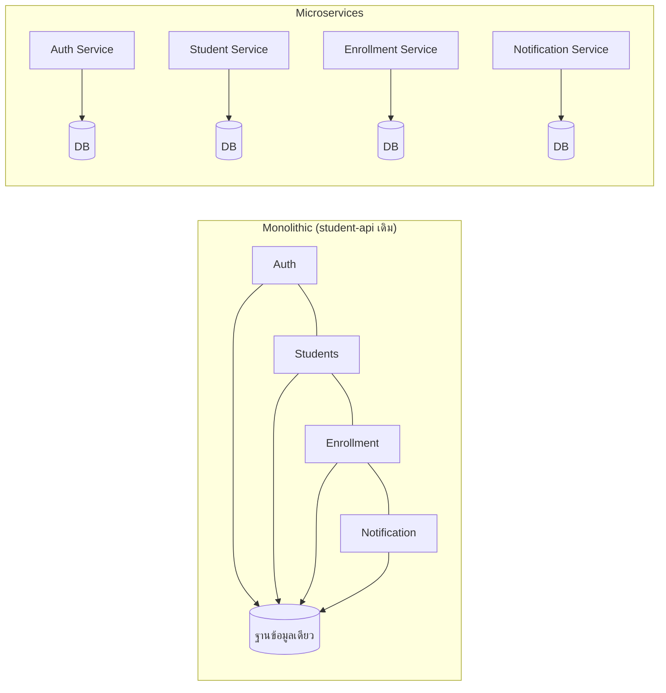
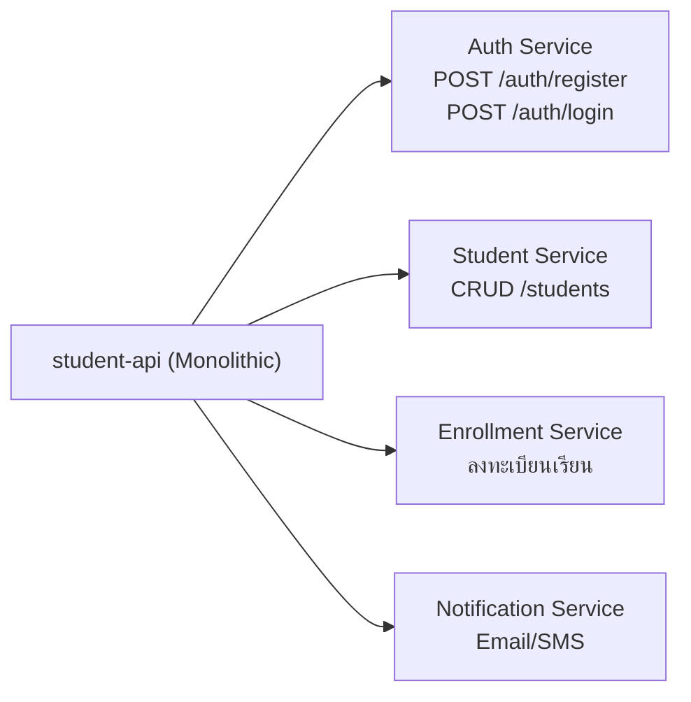
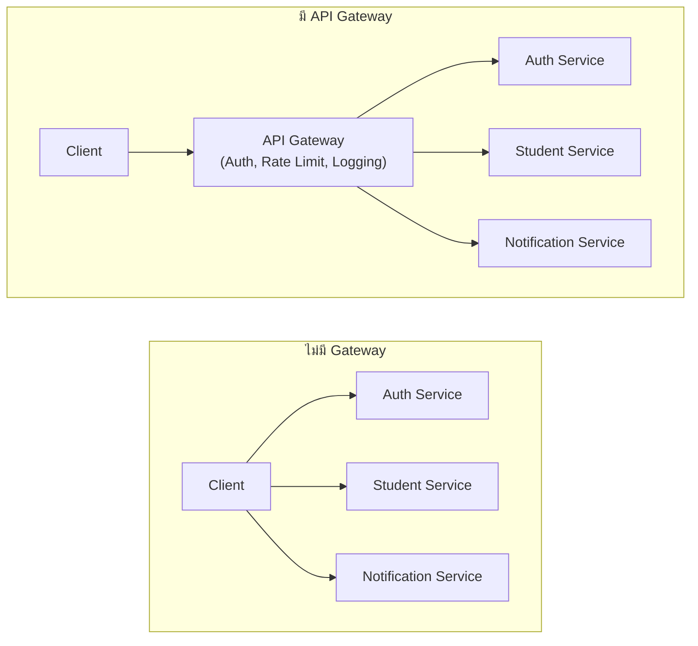
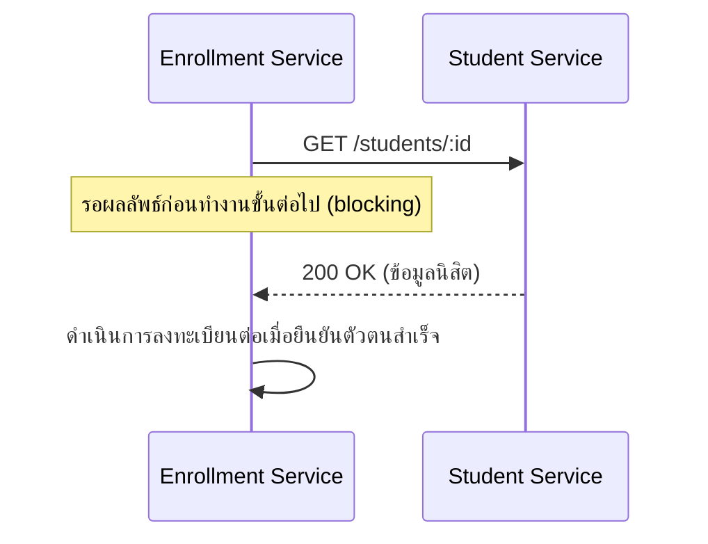
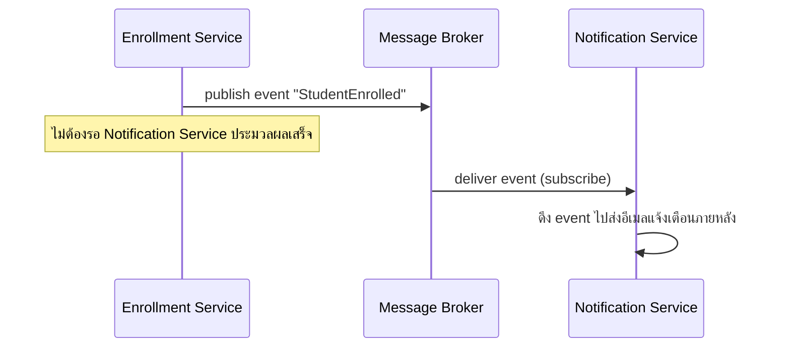
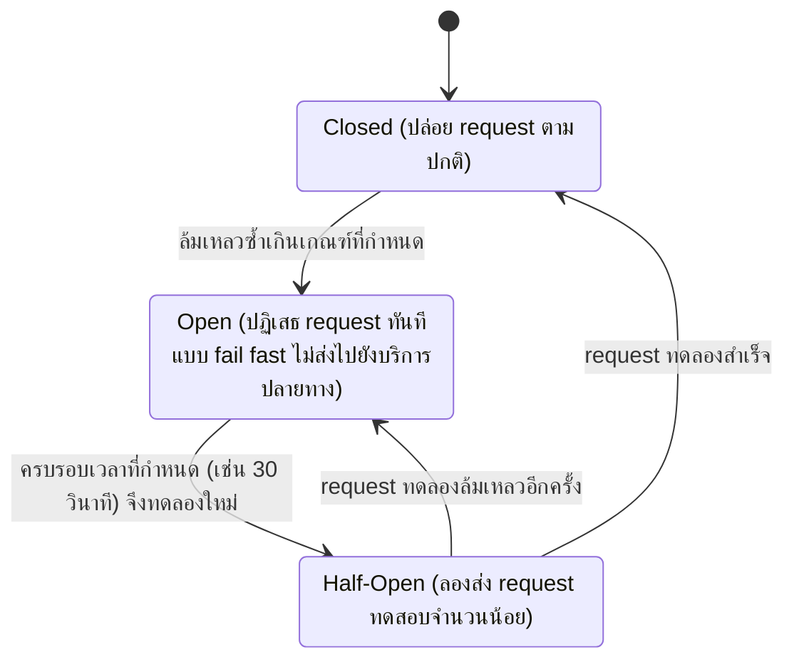

# สัปดาห์ที่ 13: Microservices Architecture

## สารบัญ

- [วัตถุประสงค์การเรียนรู้ประจำสัปดาห์](#วัตถุประสงค์การเรียนรู้ประจำสัปดาห์)
- [1. จาก Monolithic สู่ Microservices](#1-จาก-monolithic-สู่-microservices)
  - [1.1 สถาปัตยกรรมแบบ Monolithic](#11-สถาปัตยกรรมแบบ-monolithic)
  - [1.2 สถาปัตยกรรมแบบ Microservices](#12-สถาปัตยกรรมแบบ-microservices)
  - [1.3 เปรียบเทียบ Monolithic กับ Microservices](#13-เปรียบเทียบ-monolithic-กับ-microservices)
- [2. Service Decomposition](#2-service-decomposition)
  - [2.1 หลักการแบ่งบริการด้วย Bounded Context](#21-หลักการแบ่งบริการด้วย-bounded-context)
  - [2.2 เกณฑ์ที่ใช้พิจารณาว่าควรแบ่งบริการ ณ จุดใด](#22-เกณฑ์ที่ใช้พิจารณาว่าควรแบ่งบริการ-ณ-จุดใด)
- [3. API Gateway](#3-api-gateway)
  - [3.1 ปัญหาที่เกิดขึ้นเมื่อไม่มี Gateway](#31-ปัญหาที่เกิดขึ้นเมื่อไม่มี-gateway)
  - [3.2 บทบาทของ API Gateway](#32-บทบาทของ-api-gateway)
  - [3.3 ตัวอย่าง API Gateway แบบ Mock ด้วย Express](#33-ตัวอย่าง-api-gateway-แบบ-mock-ด้วย-express)
- [4. รูปแบบการสื่อสารระหว่างบริการ (Inter-Service Communication)](#4-รูปแบบการสื่อสารระหว่างบริการ-inter-service-communication)
  - [4.1 Synchronous Communication](#41-synchronous-communication)
  - [4.2 Asynchronous Communication](#42-asynchronous-communication)
  - [4.3 การจัดการความล้มเหลวระหว่างบริการ](#43-การจัดการความล้มเหลวระหว่างบริการ)
- [5. ขอบเขตของโครงงาน](#5-ขอบเขตของโครงงาน)
- [สรุปเนื้อหาสำคัญ](#สรุปเนื้อหาสำคัญ)
- [เอกสารอ้างอิง (Reference)](#เอกสารอ้างอิง-reference)
- [คำถามท้ายบท](#คำถามท้ายบท)

## วัตถุประสงค์การเรียนรู้ประจำสัปดาห์

เมื่อเรียนจบเนื้อหาในสัปดาห์นี้ นิสิตจะสามารถ

1. อธิบายแนวคิดพื้นฐานของสถาปัตยกรรมแบบ Microservices และเปรียบเทียบกับสถาปัตยกรรมแบบ Monolithic ได้อย่างถูกต้อง
2. ระบุหลักเกณฑ์ในการแบ่งบริการ (service decomposition) จากระบบ Monolithic เดิม โดยใช้แนวคิด Bounded Context
3. อธิบายบทบาทของ API Gateway ในสถาปัตยกรรมแบบ Microservices และเหตุผลที่ระบบส่วนใหญ่ต้องมี Gateway อยู่หน้าบริการย่อย
4. อธิบายรูปแบบการสื่อสารระหว่างบริการ (inter-service communication) ทั้งแบบ Synchronous และ Asynchronous พร้อมข้อดีข้อเสีย
5. ออกแบบการแบ่งบริการจากโครงงานจริงของตนเอง และทดลองเรียกข้ามบริการผ่าน API Gateway จำลอง (mock)

หัวข้อนี้สอดคล้องกับ CLO1, CLO3, CLO6 และ CLO8

---

## 1. จาก Monolithic สู่ Microservices

### 1.1 สถาปัตยกรรมแบบ Monolithic

โปรเจกต์ `student-api` ที่นิสิตพัฒนาต่อเนื่องมาตลอดรายวิชา เป็นตัวอย่างของสถาปัตยกรรมแบบ **Monolithic** คือระบบ Backend ทั้งหมด (Authentication, CRUD ของทรัพยากรต่าง ๆ, Business logic, การเชื่อมต่อฐานข้อมูล) ถูกพัฒนา ทดสอบ และ deploy เป็น process เดียวกันภายใน codebase เดียวกัน

| ลักษณะ     | รายละเอียด                                                    |
| ---------- | ------------------------------------------------------------- |
| Codebase   | เก็บอยู่ใน repository เดียว                                   |
| การ Deploy | Build และ deploy เป็นหน่วยเดียวทั้งระบบ                       |
| ฐานข้อมูล  | มักใช้ฐานข้อมูลเดียวร่วมกันทุกโมดูล                           |
| การ Scale  | ต้อง scale ทั้งระบบพร้อมกัน แม้มีเพียงบางส่วนที่รับภาระงานสูง |

Monolithic ไม่ใช่สถาปัตยกรรมที่ผิด ในทางตรงข้ามเป็นจุดเริ่มต้นที่เหมาะสมสำหรับระบบขนาดเล็กถึงกลาง ทีมขนาดเล็ก หรือช่วงเริ่มต้นของผลิตภัณฑ์ที่ยังไม่แน่ชัดว่าโดเมนธุรกิจจะแบ่งอย่างไร ซึ่งเป็นเหตุผลที่รายวิชานี้ให้นิสิตเริ่มต้นและพัฒนาโครงงานด้วยสถาปัตยกรรมนี้มาโดยตลอด

### 1.2 สถาปัตยกรรมแบบ Microservices

**Microservices** คือแนวทางการออกแบบระบบโดยแบ่งความรับผิดชอบออกเป็นบริการย่อยหลายบริการ แต่ละบริการ

- มีขอบเขตความรับผิดชอบทางธุรกิจของตนเองอย่างชัดเจน (single responsibility ในระดับบริการ)
- พัฒนา ทดสอบ และ deploy แยกจากบริการอื่นได้อย่างอิสระ
- สื่อสารกับบริการอื่นผ่านเครือข่าย (มักเป็น API หรือ message queue) แทนการเรียกฟังก์ชันภายใน process เดียวกัน
- อาจมีฐานข้อมูลเป็นของตนเอง (database per service) เพื่อลดการพึ่งพากันโดยตรงระดับข้อมูล

แผนภาพด้านล่างเปรียบเทียบโครงสร้างทั้งสองแบบ ฝั่งซ้ายแสดง Monolithic ที่ทุกโมดูลรวมอยู่ใน process เดียวและใช้ฐานข้อมูลร่วมกัน ฝั่งขวาแสดง Microservices ที่แต่ละบริการแยก process และมีฐานข้อมูลเป็นของตนเอง



### 1.3 เปรียบเทียบ Monolithic กับ Microservices

| ประเด็น                             | Monolithic                                                    | Microservices                                                                                                   |
| ----------------------------------- | ------------------------------------------------------------- | --------------------------------------------------------------------------------------------------------------- |
| ความซับซ้อนเริ่มต้น                 | ต่ำ เหมาะกับทีมเล็กและ MVP                                    | สูง ต้องจัดการเครือข่าย, service discovery, distributed data                                                    |
| การ Deploy                          | Deploy ทั้งระบบพร้อมกัน                                       | Deploy แต่ละบริการแยกอิสระ (independent deployability)                                                          |
| การ Scale                           | Scale ทั้งระบบแม้มีเพียงบางส่วนที่ต้องการ                     | Scale เฉพาะบริการที่มีภาระงานสูงได้ (เช่น scale เฉพาะ service ค้นหา)                                            |
| ความล้มเหลว                         | หากส่วนใดส่วนหนึ่ง crash อาจกระทบทั้งระบบ                     | ความล้มเหลวของบริการหนึ่งไม่ควรทำให้ทั้งระบบล่ม (ต้องออกแบบ resilience)                                         |
| ความสอดคล้องของข้อมูล (Consistency) | ทำได้ง่ายด้วย transaction เดียวในฐานข้อมูลเดียว               | ซับซ้อนขึ้นมาก เนื่องจากข้อมูลกระจายอยู่หลายฐานข้อมูล ต้องอาศัยแนวคิด eventual consistency (ดูต่อที่หัวข้อ 4.2) |
| การทดสอบ                            | ทดสอบ end-to-end ได้ง่ายกว่าเพราะทุกอย่างอยู่ใน process เดียว | ต้อง mock บริการอื่นหรือทำ integration test ข้ามบริการ                                                          |
| ทีมงานที่เหมาะสม                    | ทีมขนาดเล็กถึงกลาง                                            | องค์กรขนาดใหญ่ที่มีหลายทีมดูแลคนละบริการ                                                                        |

**ข้อควรระวังสำคัญ**: Microservices ไม่ใช่คำตอบที่ดีกว่าเสมอไป การเพิ่มความซับซ้อนของสถาปัตยกรรมต้องแลกมาด้วยต้นทุนด้านการดูแลระบบ (operational overhead) ที่สูงขึ้นมาก ทีมขนาดเล็กที่นำ Microservices มาใช้โดยไม่จำเป็นมักประสบปัญหาที่เรียกว่า "Distributed Monolith" คือระบบที่แยกเป็นหลาย service ตามรูปแบบ แต่ยังคง coupling กันแน่นเหมือน Monolithic เดิม ทำให้ได้รับข้อเสียของทั้งสองแนวทางพร้อมกัน

---

## 2. Service Decomposition

### 2.1 หลักการแบ่งบริการด้วย Bounded Context

แนวคิด **Bounded Context** มาจาก Domain-Driven Design (DDD) หมายถึงขอบเขตที่คำศัพท์และกฎทางธุรกิจมีความหมายสอดคล้องกันอย่างชัดเจนภายในขอบเขตนั้น การแบ่งบริการที่ดีควรยึดตามขอบเขตทางธุรกิจ ไม่ใช่แบ่งตามชั้นทางเทคนิค (เช่น ไม่ควรแบ่งเป็น "Database Service", "API Service", "Validation Service" เพราะแต่ละบริการจะต้องเรียกกันไปมาตลอดเวลาจนกลายเป็น distributed monolith)

ตัวอย่างการแบ่งบริการจากระบบ `student-api` (ระบบจัดการข้อมูลนิสิตที่พัฒนาต่อเนื่องมาตลอดรายวิชา)

| Bounded Context      | ความรับผิดชอบ                                         | ตัวอย่าง endpoint เดิมที่ย้ายไปอยู่บริการนี้       |
| -------------------- | ----------------------------------------------------- | -------------------------------------------------- |
| Auth Service         | การลงทะเบียน เข้าสู่ระบบ ออก Token, การจัดการ Role    | `POST /auth/register`, `POST /auth/login`          |
| Student Service      | ข้อมูลนิสิต ประวัติการศึกษา                           | `GET/POST/PUT/DELETE /students`                    |
| Enrollment Service   | การลงทะเบียนเรียนรายวิชา ตรวจสอบเงื่อนไข              | endpoint การลงทะเบียนวิชาที่อาจมีในโครงงานของนิสิต |
| Notification Service | การแจ้งเตือนผ่านอีเมล/SMS รวมถึงการเรียก external API | บริการที่ต่อยอดจากการเรียก API ภายนอก              |

### 2.2 เกณฑ์ที่ใช้พิจารณาว่าควรแบ่งบริการ ณ จุดใด

| เกณฑ์                                  | คำถามที่ควรถาม                                                                                                                                        |
| -------------------------------------- | ----------------------------------------------------------------------------------------------------------------------------------------------------- |
| ความรับผิดชอบทางธุรกิจ                 | โมดูลนี้เปลี่ยนแปลงด้วยเหตุผลทางธุรกิจเดียวกันกับโมดูลอื่นหรือไม่ (Single Responsibility ระดับบริการ)                                                 |
| อัตราการเปลี่ยนแปลง (Rate of change)   | โมดูลนี้ถูกแก้ไขบ่อยกว่าหรือน้อยกว่าโมดูลอื่นอย่างชัดเจนหรือไม่                                                                                       |
| ความต้องการด้าน Scale                  | โมดูลนี้ต้องการทรัพยากรมากกว่าส่วนอื่นในช่วงเวลาที่ต่างกันหรือไม่ (เช่น Notification Service ที่ต้องรองรับ traffic พุ่งสูงช่วงประกาศผล)               |
| ความเป็นเจ้าของข้อมูล (Data ownership) | โมดูลนี้เป็นเจ้าของข้อมูลชุดใดชุดหนึ่งโดยเฉพาะ ไม่ใช้ร่วมกับโมดูลอื่นโดยตรงหรือไม่                                                                    |
| ทีมงาน                                 | มีทีมหรือผู้รับผิดชอบแยกกันชัดเจนสำหรับแต่ละโมดูลหรือไม่ (ปัจจัยนี้สำคัญในองค์กรจริง แต่ไม่ใช่ปัจจัยหลักสำหรับโครงงานเดี่ยวในรายวิชานี้) |

แผนภาพด้านล่างแสดงการแบ่ง `student-api` ตามตารางข้างต้น โดยลูกศรแสดงทิศทางที่ endpoint เดิมถูกย้ายไปสังกัดบริการใด



หลักปฏิบัติที่แนะนำสำหรับทีมขนาดเล็ก (รวมถึงโครงงานในรายวิชานี้) คือ **"เริ่มจาก Monolith ที่ออกแบบขอบเขตภายในให้ชัดเจน (modular monolith) ก่อน แล้วจึงแยกเป็น Microservices เมื่อมีเหตุผลที่ชัดเจนรองรับ"** แทนที่จะเริ่มต้นด้วย Microservices ตั้งแต่แรกโดยไม่จำเป็น

---

## 3. API Gateway

### 3.1 ปัญหาที่เกิดขึ้นเมื่อไม่มี Gateway

เมื่อระบบถูกแบ่งเป็นหลายบริการ หาก Client (เว็บ, มือถือ) ต้องเรียกแต่ละบริการโดยตรง จะเกิดปัญหาดังนี้

1. Client ต้องทราบที่อยู่ (URL/port) ของทุกบริการ และต้องอัปเดตทุกครั้งที่มีการเปลี่ยนแปลง
2. เรื่องที่ควรทำร่วมกันในทุกบริการ เช่น Authentication, Rate Limiting, Logging ต้องเขียนซ้ำในทุกบริการ
3. การ scale หรือปิดปรับปรุงบริการหนึ่งกระทบต่อ Client โดยตรงในทันที
4. ยากต่อการควบคุมความปลอดภัยเมื่อทุกบริการเปิด endpoint ให้ Client เข้าถึงโดยตรง

แผนภาพด้านล่างเปรียบเทียบสองสถานการณ์ ฝั่งซ้ายคือเมื่อไม่มี Gateway (ปัญหาตามข้อ 1-4 ข้างต้น) ฝั่งขวาคือเมื่อมี Gateway เป็นจุดเข้าถึงเดียว



### 3.2 บทบาทของ API Gateway

**API Gateway** คือจุดเข้าถึงเดียว (single entry point) ที่อยู่หน้าบริการย่อยทั้งหมด ทำหน้าที่รับ request จาก Client แล้วส่งต่อ (route) ไปยังบริการที่เหมาะสม พร้อมทำหน้าที่ร่วมอื่น ๆ

| หน้าที่ของ API Gateway                                            | คำอธิบาย                                                            |
| ----------------------------------------------------------------- | ------------------------------------------------------------------- |
| Routing คำขอไปยังบริการที่ถูกต้องตาม path                         | เทียบได้กับ Express Router แต่ทำงานระดับเครือข่ายระหว่างบริการ      |
| ตรวจสอบ Authentication/Authorization ส่วนกลาง                     | ต่อยอดจาก JWT middleware                                            |
| Rate Limiting ส่วนกลาง                                            | จำกัดจำนวนคำขอในระดับ Gateway แทนที่จะทำแยกในแต่ละบริการ            |
| Logging และ Monitoring รวมศูนย์                                   | ต่อยอดจาก Logger middleware                                         |
| Response Aggregation (รวมผลลัพธ์จากหลายบริการเป็น response เดียว) | รูปแบบที่พบบ่อยเมื่อ Client ต้องการข้อมูลจากหลายบริการในหน้าจอเดียว |

### 3.3 ตัวอย่าง API Gateway แบบ Mock ด้วย Express

เพื่อความเข้าใจแนวคิดโดยไม่ต้องใช้เครื่องมือระดับ production (เช่น Kong, Amazon API Gateway, Nginx) ในสัปดาห์นี้นิสิตจะสร้าง API Gateway จำลองด้วย Express เอง โดยทำหน้าที่ routing และ authentication ส่วนกลางอย่างง่าย

```javascript
// gateway/index.js
const express = require("express");
const axios = require("axios");
const jwt = require("jsonwebtoken");

const app = express();
app.use(express.json());

const SERVICES = {
  students: "http://localhost:4001",
};

function authenticate(req, res, next) {
  const authHeader = req.headers.authorization;
  if (!authHeader || !authHeader.startsWith("Bearer ")) {
    return res.status(401).json({
      error: { code: "UNAUTHORIZED", message: "Missing or invalid token" },
    });
  }

  try {
    const token = authHeader.split(" ")[1];
    req.user = jwt.verify(token, process.env.JWT_SECRET);
    next();
  } catch (error) {
    return res.status(401).json({
      error: { code: "UNAUTHORIZED", message: "Invalid or expired token" },
    });
  }
}

// Gateway รับคำขอที่ path /api/v1/students/... แต่ Student Service ที่ปลายทาง
// (SERVICES.students) เปิด routeไว้ที่ /students/... โดยไม่มี /api/v1 นำหน้า
// (เพราะ /api/v1 เป็น prefix ระดับ Gateway เท่านั้น ไม่ใช่ prefix ของแต่ละบริการ)
// จึงต้องตัด "/api/v1" ออกจาก originalUrl ก่อนส่งต่อ
// เช่น /api/v1/students/5 -> /students/5
app.use("/api/v1/students", authenticate, async (req, res) => {
  try {
    const response = await axios({
      method: req.method,
      url: `${SERVICES.students}${req.originalUrl.replace("/api/v1", "")}`,
      data: req.body,
      timeout: 3000,
    });
    return res.status(response.status).json(response.data);
  } catch (error) {
    if (error.response) {
      return res.status(error.response.status).json(error.response.data);
    }
    return res.status(503).json({
      error: {
        code: "SERVICE_UNAVAILABLE",
        message: "Student service is currently unavailable",
      },
    });
  }
});

app.listen(3000, () => console.log("API Gateway running on port 3000"));
```

จุดสำคัญของตัวอย่างนี้

- Gateway ตรวจสอบ JWT เพียงจุดเดียว (ตามหลักการในหัวข้อ 3.2) แทนที่แต่ละบริการย่อยจะต้องตรวจสอบเอง
- การส่งต่อ request ใช้ Axios พร้อม `timeout` เพื่อป้องกันไม่ให้ Gateway ค้างเมื่อบริการปลายทางช้าผิดปกติ
- เมื่อบริการปลายทางไม่ตอบสนอง (ไม่มี `error.response`) Gateway คืนค่า `503 Service Unavailable` แทนการปล่อยให้ error หลุดออกไปโดยไม่มีความหมาย ซึ่งเป็นรูปแบบ Fallback

---

## 4. รูปแบบการสื่อสารระหว่างบริการ (Inter-Service Communication)

### 4.1 Synchronous Communication

บริการหนึ่งเรียกอีกบริการหนึ่งโดยตรงผ่าน HTTP/REST (หรือ gRPC ในระบบระดับ production) แล้วรอผลลัพธ์ก่อนดำเนินการต่อ ซึ่งเป็นรูปแบบเดียวกับการเรียก external API เพียงแต่ปลายทางเป็นบริการภายในระบบเดียวกันแทนที่จะเป็นบริการภายนอกองค์กร

ตัวอย่างด้านล่างสมมติว่านิสิตแบ่งโปรเจกต์ตามหัวข้อ 2.1 ออกเป็นหลายโฟลเดอร์ codebase แยกกัน เช่น `enrollment-service/` และ `student-service/` วางอยู่คนละที่ (คนละ repository หรือคนละโฟลเดอร์ย่อยก็ได้) โดย `enrollment-service` ต้องเรียกไปยัง `student-service` เพื่อตรวจสอบว่านิสิตมีตัวตนจริงก่อนลงทะเบียน

การเรียกในตัวอย่างนี้เป็นการสื่อสาร **ระหว่างบริการกับบริการ** (service-to-service) จึงเรียกตรงไปยัง `student-service` ที่พอร์ต `4001` โดยไม่ผ่าน API Gateway เนื่องจาก Gateway ในหัวข้อ 3 ทำหน้าที่เป็นจุดเข้าถึงเดียวสำหรับ Client ภายนอก (เว็บ, มือถือ) เท่านั้น ไม่ใช่ทางผ่านบังคับสำหรับการสื่อสารภายในระหว่างบริการด้วยกันเอง

```javascript
// enrollment-service/services/external-api.js ต้องคัดลอกมาจาก services/external-api.js
// ของโปรเจกต์ student-api มาไว้ในโฟลเดอร์ enrollment-service ของตนเอง
// เนื่องจากแต่ละบริการใน Microservices เป็น codebase อิสระจากกัน ไม่ใช้โฟลเดอร์ร่วมกัน

// enrollment-service/index.js เรียก student-service เพื่อตรวจสอบว่านิสิตมีตัวตนจริง
const { fetchWithRetry } = require("./services/external-api");

async function validateStudentExists(studentId) {
  const student = await fetchWithRetry(
    `http://localhost:4001/students/${studentId}`,
    3000,
    2,
  );
  return student;
}
```

| ข้อดี                                                                       | ข้อเสีย                                                                                        |
| --------------------------------------------------------------------------- | ---------------------------------------------------------------------------------------------- |
| เข้าใจง่าย ตรงไปตรงมา เหมือนการเรียก REST API ทั่วไป                        | บริการผู้เรียกต้องรอบริการปลายทางตอบกลับ (coupling ด้านเวลา)                                   |
| ได้ผลลัพธ์ทันที เหมาะกับกรณีที่ต้องใช้ผลลัพธ์ทันทีเพื่อตัดสินใจขั้นตอนถัดไป | หากบริการปลายทางล่มหรือช้า จะกระทบบริการผู้เรียกโดยตรง (จึงต้องมี Retry/Timeout/Fallback เสมอ) |

แผนภาพด้านล่างแสดงลำดับการเรียกในตัวอย่างข้างต้น สังเกตว่า Enrollment Service ต้อง **รอ** คำตอบจาก Student Service ก่อนจึงดำเนินการขั้นต่อไปได้ ซึ่งต่างจากหัวข้อ 4.2 ที่จะกล่าวถัดไป



### 4.2 Asynchronous Communication

ในรูปแบบ Asynchronous บริการผู้ส่งไม่ได้เรียกไปยังบริการปลายทางโดยตรงเหมือนหัวข้อ 4.1 แต่ส่งข้อความ (message/event) ไปเก็บไว้ที่ระบบตัวกลางก่อน ระบบตัวกลางนี้เรียกว่า **Message Queue** หรือ **Message Broker** (ตัวอย่างซอฟต์แวร์ที่ทำหน้าที่นี้ เช่น RabbitMQ, Apache Kafka) ทำหน้าที่รับข้อความจากบริการผู้ส่งมาเก็บไว้ชั่วคราว แล้วส่งต่อให้บริการปลายทางที่ลงทะเบียน (subscribe) ไว้ดึงไปประมวลผลเมื่อพร้อม

ด้วยกลไกนี้ บริการผู้ส่งจึงส่งข้อความเข้าคิวแล้วทำงานต่อได้ทันทีโดยไม่ต้องรอให้บริการปลายทางประมวลผลเสร็จก่อน ต่างจาก Synchronous ที่ต้องรอผลลัพธ์กลับมาก่อนจึงทำงานต่อได้

ตัวอย่างในชีวิตจริงที่ใช้หลักการเดียวกันนี้ เช่น เมื่อนิสิตสั่งซื้อสินค้าออนไลน์แล้วระบบแจ้ง "สั่งซื้อสำเร็จ" ทันที ทั้งที่อีเมลยืนยันหรือ SMS แจ้งเตือนยังไม่ถูกส่งถึงในขณะนั้น เบื้องหลังคือระบบ e-commerce (บริการผู้ส่ง) เพียงส่ง event "OrderPlaced" เข้า Message Broker แล้วตอบกลับนิสิตได้ทันที ส่วนบริการส่งอีเมลและบริการส่ง SMS (บริการปลายทาง) จะดึง event นี้ไปประมวลผลและส่งแจ้งเตือนภายหลังโดยไม่กระทบเวลาตอบสนองของการสั่งซื้อ

อีกตัวอย่าง เช่น เมื่อนิสิตอัปโหลดคลิปวิดีโองานนำเสนอขึ้นเว็บ ระบบจะแจ้ง "อัปโหลดสำเร็จ" ทันทีหลังไฟล์ถูกเก็บเข้าระบบ ทั้งที่การแปลงไฟล์ให้เป็นหลายความละเอียด (เช่น 480p, 720p, 1080p) ยังไม่เสร็จในขณะนั้น เบื้องหลังคือบริการอัปโหลด (บริการผู้ส่ง) ส่ง event "VideoUploaded" เข้า Message Broker แล้วตอบกลับนิสิตได้ทันที ส่วนบริการแปลงไฟล์วิดีโอ (บริการปลายทาง) จะดึง event นี้ไปประมวลผลเบื้องหลัง ซึ่งอาจใช้เวลาหลายนาทีขึ้นอยู่กับความยาวของคลิป โดยไม่ทำให้นิสิตต้องรอหน้าเว็บค้างจนกว่าการแปลงไฟล์จะเสร็จ

แผนภาพด้านล่างแสดงกลไกเดียวกันนี้ในบริบทของระบบ `student-api` ที่ใช้ตลอดทั้งไฟล์นี้ โดยสมมติว่านิสิตลงทะเบียนเรียนสำเร็จแล้ว (เทียบได้กับ "สั่งซื้อสำเร็จ" ในตัวอย่างแรก) และระบบต้องส่งอีเมลแจ้งเตือนตามหลัง (เทียบได้กับ "แปลงไฟล์วิดีโอ" ในตัวอย่างที่สอง)



| ข้อดี                                                                                                    | ข้อเสีย                                                                           |
| -------------------------------------------------------------------------------------------------------- | --------------------------------------------------------------------------------- |
| บริการผู้ส่งไม่ต้องรอบริการปลายทาง (decoupling ด้านเวลา) ทำให้ทนทานต่อความล้มเหลวของบริการปลายทางมากกว่า | ระบบมีความซับซ้อนเพิ่มขึ้น ต้องดูแล Message Broker เพิ่มเติม                      |
| รองรับ Traffic สูงได้ดีกว่า เนื่องจากข้อความสามารถรอในคิวได้                                             | ไม่ได้ผลลัพธ์ทันที ไม่เหมาะกับกรณีที่ต้องใช้ผลลัพธ์เพื่อตัดสินใจขั้นตอนถัดไปทันที |
| เหมาะกับงานที่ไม่ต้องการผลลัพธ์ทันที เช่น การส่งอีเมล การบันทึก log                                      | ต้องออกแบบรับมือกับ eventual consistency และการประมวลผลซ้ำ (idempotency)          |

#### Eventual Consistency

**Eventual consistency** (ความสอดคล้องกันในที่สุด) คือหลักการที่ข้อมูลในระบบแบบกระจาย (distributed system) ไม่จำเป็นต้องตรงกันทันทีในทุกจุดหลังมีการเปลี่ยนแปลง แต่รับประกันว่าหากไม่มีการเปลี่ยนแปลงเพิ่มเติมเข้ามาอีก ข้อมูลทุกจุดจะตรงกันในที่สุดภายในเวลาอันสั้น แนวคิดนี้เกิดขึ้นเพราะ Microservices แต่ละบริการมีฐานข้อมูลเป็นของตนเอง (ตามหัวข้อ 1.2) จึงไม่มี transaction เดียวที่ครอบคลุมทุกบริการได้เหมือนระบบ Monolithic

จากแผนภาพ sequence diagram ข้างต้น เมื่อ Enrollment Service publish event "StudentEnrolled" เสร็จแล้ว จะมีช่วงเวลาสั้น ๆ ที่

- Enrollment Service บันทึกผลการลงทะเบียนเสร็จสมบูรณ์แล้ว (ข้อมูลฝั่งนี้ถูกต้อง)
- แต่ Notification Service ยังไม่ได้รับหรือยังไม่ได้ประมวลผล event นั้น จึงยังไม่ได้ส่งอีเมลแจ้งเตือน (ข้อมูลฝั่งนี้ยังไม่ทันกัน)

ระบบจึงไม่ consistent ทันที (ไม่เหมือน Monolithic ที่ใช้ transaction เดียวบันทึกการลงทะเบียนและสร้างบันทึกแจ้งเตือนพร้อมกันได้) แต่จะ consistent ในที่สุดเมื่อ Notification Service ประมวลผล event สำเร็จ ซึ่งมักใช้เวลาเพียงไม่กี่วินาทีถึงไม่กี่นาที การยอมรับความล่าช้านี้เป็นข้อแลกเปลี่ยนที่ Asynchronous Communication ต้องแบกรับ เพื่อให้ได้ decoupling ด้านเวลาตามตารางข้อดีข้างต้น

**ขอบเขตของรายวิชา**: การฝึกภาคปฏิบัติของสัปดาห์นี้เน้นที่ Synchronous Communication ผ่าน HTTP เนื่องจากต่อยอดโดยตรงจากเทคนิค Axios/Retry/Timeout ที่เรียนไปแล้ว ส่วน Message Queue/Broker เป็นแนวคิดขั้นสูงที่กล่าวถึงเพื่อให้เห็นภาพรวม แต่อยู่นอกขอบเขตการฝึกภาคปฏิบัติของรายวิชานี้

### 4.3 การจัดการความล้มเหลวระหว่างบริการ

หลักการ Resilience (Retry, Timeout, Fallback) นำมาใช้กับการสื่อสารระหว่างบริการภายในระบบเดียวกันได้โดยตรงเช่นเดียวกับการเรียก external API เนื่องจากเมื่อระบบถูกแบ่งเป็นหลายบริการ ทุกการเรียกข้ามบริการคือการเรียกผ่านเครือข่ายที่มีโอกาสล้มเหลวหรือช้าได้เสมอ ไม่ต่างจากการเรียกบริการภายนอกองค์กร

หลักการเพิ่มเติมที่สำคัญในบริบท Microservices คือ **Circuit Breaker** ซึ่งเป็นกลไกที่หยุดส่ง request ไปยังบริการที่ล้มเหลวซ้ำ ๆ ชั่วคราว แทนที่จะ retry ไปเรื่อย ๆ จนกว่าบริการนั้นจะฟื้นตัว (ตรวจสอบเป็นระยะ) แนวคิดนี้ป้องกันไม่ให้บริการที่กำลังฟื้นตัวถูกซ้ำเติมด้วย request จำนวนมาก และช่วยให้บริการผู้เรียกล้มเหลวได้เร็ว (fail fast) แทนที่จะรอ timeout ทุกครั้ง โดย Circuit Breaker จะคอยทดสอบส่ง request ทดลองไปยังบริการปลายทางเป็นระยะ (เช่น ทุก 30 วินาที) หากบริการนั้นตอบสนองสำเร็จแล้ว จึงเริ่มส่ง request จริงให้ไปตามปกติอีกครั้ง

แผนภาพด้านล่างแสดงสถานะทั้งสามของ Circuit Breaker และเงื่อนไขการเปลี่ยนสถานะ



Circuit Breaker เป็นแนวคิดขั้นสูงที่ต่อยอดจาก Retry Logic แต่การนำไปใช้จริงมักอาศัยไลบรารีเฉพาะทาง จึงอยู่นอกขอบเขตการฝึกภาคปฏิบัติของรายวิชานี้ นิสิตที่สนใจสามารถศึกษาเพิ่มเติมได้จาก [microservices.io](https://microservices.io/patterns/reliability/circuit-breaker.html)

---

## 5. ขอบเขตของโครงงาน

เนื้อหาสัปดาห์นี้เป็นการฝึกออกแบบสถาปัตยกรรมเพื่อสร้างความเข้าใจแนวคิด Microservices ในภาพรวม ไม่ได้กำหนดให้นิสิตต้องย้ายระบบโครงงานจริงไปเป็น Microservices อย่างสมบูรณ์ เนื่องจากโครงงานหลักของรายวิชายังคงพัฒนาต่อเนื่องแบบ Monolithic ตามที่ออกแบบไว้ตั้งแต่โครงงานระยะที่ 1

---

## สรุปเนื้อหาสำคัญ

1. Microservices คือการแบ่งระบบออกเป็นบริการย่อยที่มีขอบเขตความรับผิดชอบชัดเจน พัฒนาและ deploy แยกจากกันได้ แต่แลกมาด้วยความซับซ้อนด้านการดูแลระบบที่สูงขึ้น ไม่ใช่ทางเลือกที่ดีกว่า Monolithic เสมอไป
2. การแบ่งบริการควรยึดตามขอบเขตทางธุรกิจ (Bounded Context) ไม่ใช่แบ่งตามชั้นทางเทคนิค เพื่อหลีกเลี่ยงปัญหา Distributed Monolith
3. API Gateway เป็นจุดเข้าถึงเดียวที่ทำหน้าที่ routing, authentication, rate limiting และ logging ร่วมส่วนกลาง ช่วยลดภาระ Client และลดการเขียนโค้ดซ้ำในแต่ละบริการ
4. การสื่อสารระหว่างบริการมีสองรูปแบบหลักคือ Synchronous (รอผลลัพธ์ทันที เหมาะกับกรณีที่ต้องใช้ผลลัพธ์ทันที) และ Asynchronous (ผ่าน Message Queue ไม่ต้องรอ เหมาะกับงานที่ไม่ต้องการผลลัพธ์ทันที)
5. หลักการ Resilience (Retry, Timeout, Fallback) จากสัปดาห์ที่ 11 ใช้ได้กับการเรียกระหว่างบริการภายในระบบเดียวกันเช่นเดียวกับการเรียก external API
6. ทีมขนาดเล็กควรเริ่มจาก Modular Monolith ที่ออกแบบขอบเขตภายในให้ชัดเจนก่อน แล้วจึงพิจารณาแยกเป็น Microservices เมื่อมีเหตุผลรองรับชัดเจน

---

## เอกสารอ้างอิง (Reference)

1. microservices.io. _Microservices Architecture Pattern_. สืบค้นจาก https://microservices.io
2. microservices.io. _Circuit Breaker Pattern_. สืบค้นจาก https://microservices.io/patterns/reliability/circuit-breaker.html
3. Axios. _Axios Documentation_. สืบค้นจาก https://axios-http.com/docs/intro
4. Express. _Express Documentation_. สืบค้นจาก https://expressjs.com
5. Node.js. _Node.js Documentation_. สืบค้นจาก https://nodejs.org/docs
6. JWT. _Introduction to JSON Web Tokens_. สืบค้นจาก https://jwt.io/introduction
7. MDN Web Docs. _HTTP Response Status Codes_. สืบค้นจาก https://developer.mozilla.org/en-US/docs/Web/HTTP/Status

---

## คำถามท้ายบท

1. จงเปรียบเทียบข้อดีและข้อเสียของสถาปัตยกรรมแบบ Monolithic และ Microservices อย่างน้อยด้านละ 3 ประเด็น
2. เพราะเหตุใดการแบ่งบริการตามชั้นทางเทคนิค (เช่น แยก Database Service, Validation Service) จึงมักนำไปสู่ปัญหา Distributed Monolith
3. จงอธิบาย Bounded Context และยกตัวอย่างการแบ่งบริการจากระบบโครงงานของตนเองอย่างน้อย 3 บริการ
4. API Gateway มีบทบาทอย่างไรในสถาปัตยกรรมแบบ Microservices และหากไม่มี Gateway จะเกิดปัญหาใดบ้าง
5. จงเปรียบเทียบ Synchronous และ Asynchronous Communication ระหว่างบริการ พร้อมยกตัวอย่างสถานการณ์ที่เหมาะสมกับแต่ละรูปแบบ
6. Circuit Breaker แตกต่างจาก Retry Logic ที่เรียนในสัปดาห์ที่ 11 อย่างไร และแก้ปัญหาใดที่ Retry Logic เพียงอย่างเดียวแก้ไม่ได้
7. เพราะเหตุใดทีมขนาดเล็กจึงควรพิจารณาเริ่มต้นด้วย Modular Monolith ก่อนแยกเป็น Microservices แทนที่จะเริ่มต้นด้วย Microservices ตั้งแต่แรก
8. จงออกแบบ (เขียนเป็นตารางหรือ diagram) การแบ่งบริการของระบบโครงงานของตนเองออกเป็นอย่างน้อย 3 บริการ พร้อมระบุว่าแต่ละบริการสื่อสารกันด้วยรูปแบบใด (Synchronous หรือ Asynchronous) และเพราะเหตุใด
